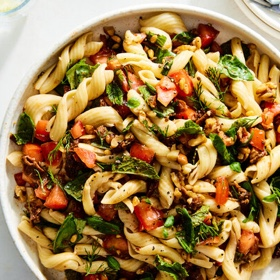

---
categories:
- 9B3E8F54-7F9D-4782-919F-ACC9A0850C87
- 60FB6093-F8C4-447B-A9A2-81A75BBCBA70
- 460F3A6B-0B87-457B-AF84-A1CE51D92D74
- 088012EF-69C0-412F-BD34-160FE5B0E043
cook_time: 35 minutes
created: '2022-07-21 10:04:37'
difficulty: ''
hash: 008c210baf607b0c40ff2f25db53c006da1016d3924674e1068fe661ef49e7c3
image_url: https://static01.nyt.com/images/2022/06/29/dining/27COOKOUTREX2-double-tomato-pasta-salad/merlin_207624003_5bb1aeca-1a30-4c82-8964-fada2992127c-articleLarge.jpg
in_trash: false
is_pinned: false
on_favorites: false
on_grocery_list: false
prep_time: ''
rating: 5
scale: null
servings: 4-6 servings
source: cooking.nytimes.com
source_url: https://cooking.nytimes.com/recipes/1023285-double-tomato-pasta-salad
total_time: 35 min
uid: 7E491BA9-0417-4667-8772-DCB929497680
---

# Double-Tomato Pasta Salad

## Ingredients

- 1 (7-8 oz) jar sun-dried tomatoes packed in oil
- 1 1/2 cups raw pine nuts, walnuts, hazelnuts or almonds, coarsely chopped
- 1/4 cup extra-virgin olive oil
- 2 garlic cloves, finely grated
- Kosher salt (such as Diamond Crystal)
- Freshly ground black pepper
- 1 lb long or twirly noodles, like linguine or fusilli
- 2 lb ripe tomatoes
- Lemon juice or red wine vinegar, to taste
- 2 cups torn basil, mint, dill or arugula leaves, or a combination

## Directions

Holding back the sun-dried tomatoes with your fingers, drain the oil from the jar into a large pot. Coarsely chop the sun-dried tomatoes and add them to the pot, along with the nuts and olive oil. Set over medium-low and cook, stirring often, until the nuts are toasted, 5-6 minutes. Scrape into a large bowl (reserve the pot), then stir in the garlic and 1/2 tsp each salt and pepper. 

Fill the reserved pot with water (no need to wash) and bring to a boil. Season water with salt, add the pasta and cook until just past al dente. (The pasta will not cook further in the sauce.) Drain the pasta.

While the water is coming to a boil, coarsely chop the ripe tomatoes. Add to the sun-dried tomato mixture, season with 1 tsp salt and stir to combine. (Tomato mixture can be made up to 2 hours ahead.)

Add the drained pasta to the tomato mixture and stir to combine. Let sit until room temperature, about 15 minutes or up to 2 hours. Pasta salad will keep up to 3 days if refrigerated. 

When ready to eat, taste the pasta salad. If flavors are muted, add salt and lemon juice or red wine vinegar. If it’s too sweet, add black pepper and lemon juice or red wine vinegar. Stir in the greens and eat.
