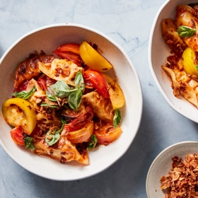

---
categories:
- A6695F02-BB88-4BF3-9B3A-4F3FB0ACFBBA
- 60FB6093-F8C4-447B-A9A2-81A75BBCBA70
- 9B27D475-7644-4A83-9A71-DACE79FB649E
- 98E4F68D-11D7-4383-90FA-22C804880E1C
cook_time: ''
created: '2023-07-15 13:34:45'
difficulty: ''
hash: da730f5ec951d7bda13666fc87e223fb12dc1d6625d401827aa5d094d44e1e94
image_url: https://static01.nyt.com/images/2023/06/13/multimedia/as-dumpling-salad-lvtc/as-dumpling-salad-lvtc-mediumSquareAt3X.jpg
in_trash: false
is_pinned: false
on_favorites: false
on_grocery_list: false
prep_time: ''
rating: 0
scale: null
servings: 4 servings
source: cooking.nytimes.com
source_url: https://cooking.nytimes.com/recipes/1024075-dumpling-tomato-salad-with-chile-crisp-vinaigrette?ds_c=71700000052595478&gbraid=0AAAAADwd30jI453zUEyvECZIYDCvkxXbb&gclid=EAIaIQobChMIoe-E0J-RgAMVDYrICh1AZgipEAAYASAAEgLulvD_BwE&gclsrc=aw.ds
total_time: 20 min
uid: 12658B51-F120-4A0B-A933-C7670E263842
---

# Dumpling Tomato Salad with Chile Crisp Vinaigrette

## Ingredients

- 2 1/2 lb ripe tomatoes (any variety), cut into roughly 1-2 inch pieces (at room temperature)
- 1 garlic clove, grated
- 1/2 cup basil leaves, torn
- Kosher salt (such as Diamond Crystal brand) and black pepper
- 1 lb frozen potsticker dumplings (not thawed)
- Neutral oil, such as canola or vegetable
- 1-2 tbsp store-bought crispy fried shallots (optional)
- 3 tbsp chile crisp (or chile oil)
- 2 tbsp rice vinegar
- 1 tbsp soy sauce, or more to taste

## Directions

Place the tomatoes on a large serving plate or in a bowl. Add the garlic, half the basil leaves, 1 tsp of salt and a big pinch of black pepper. Toss to combine and set aside.

To make the vinaigrette, combine the chile crisp, rice vinegar and soy sauce and whisk to combine. Taste and if it needs more saltiness, add 1/2 tsp more soy sauce.

Heat a large (12-inch) nonstick or well-seasoned cast-iron skillet over medium high for 1-2 minutes until very hot. Add 1-2 tbsp of oil and, working in batches, add the dumplings, flat-side down, and cook until the bottoms of the dumplings are lightly browned, 1-2 minutes. Immediately add about 1/4 cup of water to the pan, just enough to cover the base of the dumplings, then cover and cook until the water has evaporated, 3-4 minutes. (If your dumplings contain meat, cook for an extra 1-2 minutes, or according to packet instructions). Transfer the cooked dumplings to a plate and continue cooking the remaining dumplings. (If you prefer to steam the dumplings, see Tip.)

To serve, place the warm dumplings over the tomato salad and drizzle with the chile crisp vinaigrette. Toss very gently. Top with the crispy fried shallots (if using) and the remaining basil leaves. Serve either while the dumplings are still warm or at room temperature.

## Notes

To steam, arrange the dumplings in a steaming basket lined with baking paper or cabbage leaves, place over a pan of boiling water and steam for 10-15 minutes.
