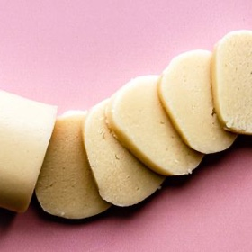

---
categories:
- A3FA97E2-41F7-4C28-8433-211311D4E130
cook_time: 0 mins
created: '2021-12-12 08:53:35'
difficulty: ''
hash: f99c49074f0e99bedbc661113c170e9d72e23b6889732169f8e0d3adecc6879b
image_url: https://www.thespruceeats.com/thmb/AaOwif4kW88t5UgtelCRYvexiwQ=/450x0/filters:no_upscale():max_bytes(150000):strip_icc()/easy-almond-paste-521145-hero-01-0b4463f6498c43758a27d8f605a16cbf.jpg
in_trash: false
is_pinned: false
on_favorites: false
on_grocery_list: false
prep_time: 15 mins
rating: 0
scale: null
servings: 'Servings: 16 servings'
source: thespruceeats.com
source_url: https://www.thespruceeats.com/easy-almond-paste-521145
total_time: ''
uid: C19898BC-A40B-49D4-B7CC-90E13FECDB84
---

# Easy Almond Paste

## Ingredients

- 1 1/2 cups whole blanched almonds
- 1 1/2 cups sifted powdered sugar, divided
- 1 large egg white, lightly beaten, at room temperature
- 1/2 tsp almond extract, optional

## Directions

Gather the ingredients.

Place the whole blanched almonds and 1/2 cup of the powdered sugar in a large, 7-cup food processor fitted with a steel blade. Process the nuts and sugar until the nuts are very finely ground, stopping periodically to scrape the sides of the processor bowl. The sugar will help prevent the nuts from turning into almond butter, but still be careful about overprocessing.

Once the almonds are very finely ground, add the rest of the powdered sugar and pulse until it is completely mixed into the ground almonds.

Stop the processor and add the egg white and the almond extract, if using.

Turn the processor back on and process the almond paste until it comes together to form a clump.

If it seems very sticky, add a little more powdered sugar, a spoonful at a time, until it is smooth.

You can use the almond paste at once or wrap it to use at a later date. If keeping for future use, form into a log and wrap well in plastic wrap.

Store in a zip-top bag in the refrigerator or freezer.

Enjoy.

## Nutritional Information

(per serving)
122 Calories 7 g Fat 13 g Carbs 3 g Protein
Nutrition Facts
Servings: 16
Amount per serving
Calories 122
% Daily Value*
Total Fat 7 g 9%
Saturated Fat 1 g 3%
Cholesterol 12 mg 4%
Sodium 69 mg 3%
Total Carbohydrate 13 g 5%
Dietary Fiber 1 g 5%
Total Sugars 11 g
Protein 3 g
Vitamin C 0 mg 0%
Calcium 37 mg 3%
Iron 1 mg 3%
Potassium 97 mg 2%
*The % Daily Value (DV) tells you how much a nutrient in a food serving contributes to a daily diet. 2,000 calories a day is used for general nutrition advice.
