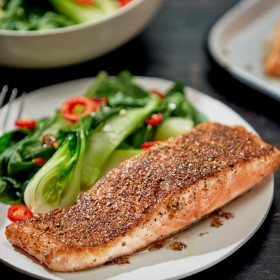

---
categories:
- 135D8DF8-5165-487A-9161-61345003AB1B
- 0E6E410A-45EC-4274-98C8-2190B87DB54A
- 1C21D75E-3CF2-4B23-B04F-A9275BC1033B
- 98E4F68D-11D7-4383-90FA-22C804880E1C
cook_time: 20 minutes
created: '2020-01-26 10:47:25'
difficulty: ''
hash: 1d539e826a33b28290f9d002a818b9126a6bc6cb09bedc9a0b015488dc0342ed
image_url: https://static01.nyt.com/images/2017/12/13/dining/13COOKING-4SPICE-SALMON1/13COOKING-4SPICE-SALMON1-articleLarge.jpg
in_trash: false
is_pinned: false
on_favorites: false
on_grocery_list: false
prep_time: ''
rating: 0
scale: null
servings: Yield 4 servings
source: Cooking.nytimes.com
source_url: https://cooking.nytimes.com/recipes/1014578-four-spice-salmon
total_time: ''
uid: E0CF386C-1D2A-4D48-8E1B-12AFAAA8F164
---

# Four-Spice Salmon

## Ingredients

- 4 (6 oz) skinned salmon fillets
- Salt and black pepper
- 1 tbsp coriander seeds or ground coriander
- 1/4 tsp whole or ground cloves
- 1 1/2 tsp cumin seed or ground cumin
- 1 tsp freshly grated nutmeg
- 2 tbsp peanut oil, grape seed or other neutral oil, or clarified butter

## Directions

Season fillets on both sides with salt and pepper. If necessary, combine spices and grind them to a coarse powder in a coffee or spice grinder. Press some of the mixture onto the top of each fillet.

Heat a large nonstick skillet over medium-high heat for 2 or 3 minutes. Add the oil or butter and, when it shimmers, place the fillets, coated side down, in the pan. Cook about 2-3 minutes, or until the spice mixture forms a nicely browned crust.

Turn the fillets and cook for another 2-3 minutes, or until the salmon just slightly resists when pierced with a thin-bladed knife.
