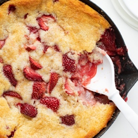

---
categories:
- 6BF378BD-8FD0-4FEF-9755-940308F0C8C7
- 60FB6093-F8C4-447B-A9A2-81A75BBCBA70
- E5311B89-BA3B-4153-9D9E-C809730BC236
- 2BBE169B-4709-4377-8F54-765FFAAD9E1A
cook_time: 55 mins
created: '2022-05-21 14:03:52'
difficulty: ''
hash: a4aa32b64b06aa4ab3d36573494f911835730e88e7d665584838edb471ece178
image_url: https://iambaker.net/wp-content/uploads/2021/04/straw-cobbler-4-1200x1800.jpg
in_trash: false
is_pinned: false
on_favorites: false
on_grocery_list: false
prep_time: 20 mins
rating: 0
scale: null
servings: 'Servings: 8 calories: 372 kcal'
source: iambaker.net
source_url: https://iambaker.net/fresh-strawberry-cobbler/
total_time: ''
uid: 894F64F1-B3B5-4727-88B0-897257CCDDEB
---

# Fresh Strawberry Cobbler

## Ingredients

- BATTER
- ½ cup (1 stick or 113g) butter, melted
- 1 cup (200g) granulated sugar
- 1 cup (125g) all-purpose flour
- 1½ teaspoons baking powder
- ½ teaspoon kosher salt
- 1 cup milk
- STRAWBERRY MIXTURE
- 2 pounds fresh strawberries, washed, dried, hulled, and halved
- ½ cup (100g) granulated sugar
- 2 tablespoons cornstarch
- 2 teaspoons lemon juice
- SUGAR TOPPING
- 1½ tablespoons turbinado sugar

## Directions

Preheat the oven to 350°F and spray a 10-inch cast-iron skillet with nonstick cooking spray. (You could also use a 9x13-inch baking dish.)

BATTER

In a medium bowl, combine sugar, flour, baking powder, salt, and milk. Slowly whisk in the melted butter. Pour the batter into the skillet.

STRAWBERRY MIXTURE

In a medium bowl, toss the strawberries with sugar, cornstarch, and lemon juice. Add the strawberry mixture evenly over the top of the batter.

Bake for 45 minutes. (Line a baking sheet with aluminum foil and place it on the bottom of the oven to catch any drips.)

SUGAR TOPPING

After 45 minutes, sprinkle the turbinado sugar over the top and return to oven; bake an additional 10-15 minutes, or until golden brown.

Serve topped with ice cream or whipped topping.

## Nutritional Information

SERVINGS: 8 CALORIES: 372 KCAL
