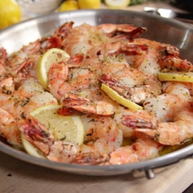

---
categories:
- 135D8DF8-5165-487A-9161-61345003AB1B
- 74D19AD7-7FB6-416E-B539-74DCDC2A820A
- 3C8ADFAF-87C1-4C30-AA13-572072B4B626
- 2BBE169B-4709-4377-8F54-765FFAAD9E1A
cook_time: 40 min
created: '2021-03-09 07:33:55'
difficulty: Easy
hash: 19babdc7ffd1603a503ff799531ed28cbdfebeebc64c7e72c06e0baa6177d63c
image_url: https://food.fnr.sndimg.com/content/dam/images/food/fullset/2017/5/18/0/BX1302H_Garlic-and-Herb-Roasted-Shrimp_s4x3.jpg.rend.hgtvcom.826.620.suffix/1495125455576.jpeg
in_trash: false
is_pinned: false
on_favorites: false
on_grocery_list: false
prep_time: 20 min
rating: 0
scale: null
servings: 'Yield: 4 servings'
source: foodnetwork.com
source_url: https://www.foodnetwork.com/recipes/ina-garten/garlic-and-herb-roasted-shrimp-3742576
total_time: ''
uid: B7037DD9-6F5A-401D-8DA4-77A10BB1C4F9
---

# Garlic & Herb Roasted Shrimp

## Ingredients

- 1/4 pound (1 stick) unsalted butter
- 2 tablespoons good olive oil
- 2 tablespoons minced garlic (6 cloves)
- 2 teaspoons minced fresh rosemary leaves
- 1/4 teaspoon crushed red pepper flakes
- Kosher salt and freshly ground black pepper
- 2 large lemons
- 2 pounds (8- to 10-count) shrimp, peeled with the tails on
- 1 teaspoon coarse sea salt
- 4 slices country bread, toasted

## Directions

Preheat the oven to 400 degrees.

Melt the butter over low heat in a medium (10-inch) saute pan. Add the olive oil, garlic, rosemary, red pepper flakes, 1 teaspoon kosher salt, and 1/2 teaspoon black pepper and cook over low heat for one minute. Off the heat, zest one of the lemons directly into the butter mixture.

Meanwhile, arrange the shrimp snugly in one layer in a large (12-inch) round ovenproof sauté pan (or 10 × 13-inch baking dish) with only the tails overlapping. Pour the butter mixture over the shrimp. Sprinkle with the sea salt and 1/2 teaspoon black pepper. Slice the ends off the zested lemon, cut five (1/4-inch-thick) slices, and tuck them among the shrimp. Roast for 12 to 15 minutes, just until the shrimp are firm, pink, and cooked through. Cut the remaining lemon in half and squeeze the juice onto the shrimp. Serve hot with the toasted bread for dipping into the garlic butter.
