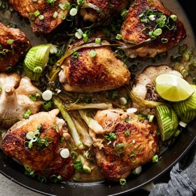

---
categories:
- 135D8DF8-5165-487A-9161-61345003AB1B
- E131025A-19E9-4C5F-99A8-75EE51F165D8
- 1C21D75E-3CF2-4B23-B04F-A9275BC1033B
- 2BBE169B-4709-4377-8F54-765FFAAD9E1A
cook_time: 35 minutes
created: '2020-03-22 14:42:41'
difficulty: ''
hash: 9928d110820708489d9e20dc7580b0340d59360cec28b199b67cb4e3b5217f4d
image_url: https://static01.nyt.com/images/2018/10/24/dining/ar-chicken-scallions-lime/merlin_145231437_0eb34433-46b7-49a8-85f9-b8c1260db84c-articleLarge.jpg
in_trash: false
is_pinned: false
on_favorites: false
on_grocery_list: false
prep_time: ''
rating: 0
scale: null
servings: Yield 4 servings
source: cooking.nytimes.com
source_url: https://cooking.nytimes.com/recipes/1018911-garlicky-chicken-thighs-with-scallion-and-lime
total_time: ''
uid: EE4DDBC3-D9E0-4987-9131-DA6E46B78923-60208-00002990E95331AF
---

# Garlicky Chicken Thighs with Scallion and Lime

## Ingredients

- 1 ½ pounds bone-in, skin-on chicken thighs
- Kosher salt and freshly ground pepper
- 1 tablespoon canola oil
- 1 bunch scallions
- 1 head garlic, unpeeled and halved crosswise
- 2 cloves garlic, peeled and finely grated
- 2 tablespoons fresh lime juice, plus 1 lime
- 1 tablespoon low-sodium soy sauce

## Directions

Season chicken with salt and pepper on both sides.

Heat oil in a large Dutch oven or large, high-sided skillet over medium heat.

Add chicken, skin-side down and cook, undisturbed, until chicken is crisped and the fat has begun to render, 8 to 10 minutes. Using tongs, carefully flip chicken skin-side up. Cook until golden brown, 4 to 6 minutes.

Meanwhile, thinly slice two scallions; set aside.

Add both halves of the head of garlic, cut side down, and remaining whole scallions to the pot and season with salt and pepper, tossing to coat in the chicken fat. Cook until scallions are lightly blistered and browned, about 3 minutes. Add grated garlic and stir a minute or two, but do not brown.

Add lime juice, soy sauce and 1 cup of water. Bring to a simmer and partly cover. Cook until chicken is completely tender and nearly falling apart on the underside and liquid is reduced by three-quarters, 15 to 20 minutes. Discard the halved head of garlic.

Scatter sliced scallion over chicken and using a Microplane or zester, zest lime over. Cut lime into quarters and serve alongside.

## Nutritional Information

Calories: 448
Total Carbohydrates: 10 grams
Total Fat: 32 grams
Dietary fiber: 2 grams
Protein: 30 grams
Saturated fat: 8 grams
Sodium: 569 milligrams
Sugar: 1 gram
Trans Fat: 0 grams
Unsaturated fat: 14 grams
