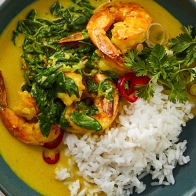

---
categories:
- 135D8DF8-5165-487A-9161-61345003AB1B
- 74D19AD7-7FB6-416E-B539-74DCDC2A820A
- 641901A6-C962-46DC-B418-1C19B51409EF
- 98E4F68D-11D7-4383-90FA-22C804880E1C
cook_time: ''
created: '2025-03-16 11:56:20'
difficulty: ''
hash: 6b40c392cb67def17d5d59d1bf38a7ba656ce92582448aed38d102bb8ca06022
image_url: https://static01.nyt.com/images/2022/05/18/dining/yf-Ginger-Garlic-Shrimp-With-Coconut-Milk/yf-Ginger-Garlic-Shrimp-With-Coconut-Milk-videoSixteenByNineJumbo1600-v2.jpg
in_trash: false
is_pinned: false
on_favorites: false
on_grocery_list: false
prep_time: ''
rating: 0
scale: null
servings: 4 servings
source: cooking.nytimes.com
source_url: https://cooking.nytimes.com/recipes/1023206-ginger-garlic-shrimp-with-coconut-milk
total_time: 20 min
uid: E95D4303-C50C-4414-85A9-74806AC69C9D
---

# Ginger-Garlic Shrimp with Coconut Milk

## Ingredients

- 2 large garlic cloves, minced or grated
- 1 tsp minced or grated ginger
- 1 tsp ground turmeric
- Kosher salt and black pepper
- 1 tbsp olive oil
- 1 lb large shrimp, peeled and deveined, tails on or off
- 2 tbsp vegetable oil
- 1 (14 oz) can full-fat coconut milk
- 1 tbsp soy sauce
- 3 packed cups baby spinach
- 1 lime, halved
- 1 fresno, jalapeño or serrano chile, thinly sliced
- 2 scallions, white and light green parts, thinly sliced
- 1/2 packed cup cilantro leaves and tender stems, roughly chopped
- Steamed rice, vermicelli noodles or naan, for serving

## Directions

In a mixing bowl, mix together the garlic, ginger, turmeric, 1 tsp salt, 1/2 tsp pepper and the olive oil. Add the shrimp and mix to coat well.

Heat the vegetable oil in a large skillet over medium-high until shimmering. Add the shrimp in an even layer and cook, undisturbed, for 2 minutes. Pour in the coconut milk and soy sauce, stir to combine and turn the shrimp. Raise the heat to high and adjust it to maintain a simmer (avoid bringing to a boil), and cook until the liquid is slightly thickened and shrimp are almost cooked through, stirring occasionally, about 3 minutes. Stir in the spinach in batches until wilted.

Remove from the heat and squeeze in the juice from a lime half. Adjust seasoning with more lime and salt as needed. Top with the chiles, scallions and cilantro, and serve with rice, noodles or naan.

## Nutritional Information

Trans Fat: 0 g
Fat: 32 g
Calories: 469
Saturated Fat: 20 g
Unsaturated Fat: 11 g
Sodium: 736 milligrams
Sugar: 1 g
Fiber: 2 g
Carbohydrate: 22 g
Protein: 27 g
