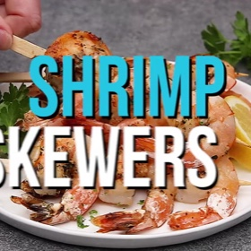

---
categories:
- 135D8DF8-5165-487A-9161-61345003AB1B
- 74D19AD7-7FB6-416E-B539-74DCDC2A820A
- 1C21D75E-3CF2-4B23-B04F-A9275BC1033B
- 29FDEC25-D5A4-4D29-A800-2D2E46095301
cook_time: 10 minutes
created: '2020-09-13 15:13:12'
difficulty: ''
hash: fd8c90e625621ac9a1357fe7ee209baa1b1e6efc6970558fed3c4e04c3d13573
image_url: https://cdn.jwplayer.com/v2/media/A4SVKIly/poster.jpg?width=720
in_trash: false
is_pinned: false
on_favorites: false
on_grocery_list: false
prep_time: 5 minutes
rating: 0
scale: null
servings: Calories 206kcal
source: dinneratthezoo.com
source_url: https://www.dinneratthezoo.com/grilled-shrimp-skewers/#wprm-recipe-container-13686
total_time: ''
uid: 30D37931-78CF-40F9-AB80-E86F5B4AE4EF-10837-000005014F1223FF
---

# Grilled Shrimp Skewers

## Ingredients

- 1 pound large shrimp peeled and deveined (you can either leave tails on or remove them)
- 1/4 cup olive oil
- 2 tablespoons lemon juice
- 3/4 teaspoon salt
- 1/4 teaspoon pepper
- 1 teaspoon Italian seasoning
- 2 teaspoons minced garlic
- 1 tablespoon chopped parsley
- lemon wedges for serving

## Directions

Place the olive oil, lemon juice, salt, pepper, Italian seasoning and garlic in a resealable plastic bag. Seal and shake to combine.

Add the shrimp to the bag and seal. Toss to coat evenly with the marinade.

Marinate for at least 15 minutes or up to 2 hours. You don't want to marinate for longer than that, as the acid in the lemon juice will start to cook the shrimp.

Thread the shrimp onto skewers. Heat a grill or grill pan over medium high heat.

Place the skewers on the grill. Cook for 2-3 minutes on each side or until shrimp are pink and opaque.

Broiler directions: Preheat the broiler. Place the shrimp skewers on a sheet pan coated with cooking spray. Broil for 2-3 minutes on each side or until shrimp are pink and opaque.

Sprinkle with parsley and serve with lemon wedges.

## Nutritional Information

Calories 206kcal
Calories: 206kcal | Protein: 23g | Fat: 10g | Saturated Fat: 2g | Cholesterol: 285mg | Sodium: 1317mg | Potassium: 90mg | Vitamin C: 7.6mg | Calcium: 172mg | Iron: 2.7mg
