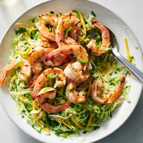

---
categories:
- 135D8DF8-5165-487A-9161-61345003AB1B
- 74D19AD7-7FB6-416E-B539-74DCDC2A820A
- 9B27D475-7644-4A83-9A71-DACE79FB649E
- 29FDEC25-D5A4-4D29-A800-2D2E46095301
cook_time: ''
created: '2024-05-27 13:38:12'
difficulty: ''
hash: 415d3fbd233d772e9c22dc560fdcf4a6b400baeeaec6efb5fc21d397c1b7eb23
image_url: https://static01.nyt.com/images/2023/05/03/multimedia/ya-spicy-cabbage-slaw-lvhp/ya-spicy-cabbage-slaw-lvhp-square640.jpg
in_trash: false
is_pinned: false
on_favorites: false
on_grocery_list: false
prep_time: ''
rating: 0
scale: null
servings: 4 servings
source: cooking.nytimes.com
source_url: https://cooking.nytimes.com/recipes/1024054-grilled-shrimp-with-spicy-slaw
total_time: 20 min
uid: 3511D50C-6CA4-4AC8-9664-17A1E640AD42
---

# Grilled Shrimp with Spicy Slaw

## Ingredients

- 1/4 cup freshly squeezed orange juice (from 1 orange)
- 3 tablespoons freshly squeezed lime juice (from 2 limes)
- 1/4 cup neutral oil
- 2 tablespoons honey
- 2 tablespoons thinly sliced jalapeño (or more, to taste)
- 1/2 teaspoon kosher salt (such as Diamond Crystal)
- 1 pound large (16 to 20 count) peeled and deveined shrimp
- 4 packed cups thinly shredded green cabbage (1/2 medium head)
- 1 mango (optional), peeled and julienned
- 1 cup chopped cilantro
- 2 thinly sliced scallions

## Directions

Make the dressing: In a large bowl, whisk together the orange juice, lime juice, oil, honey, jalapeño and salt. Taste and add more jalapeño if you’d like more heat.

Add 2 tablespoons of the dressing to a medium bowl and toss with the shrimp; let the shrimp marinate while you heat a grill or grill pan over medium-high.

Reserve 2 tablespoons of the dressing from the large bowl, then add the cabbage, mango (if using), cilantro and scallions to the large bowl; toss to coat.

Grill the shrimp until lightly charred and cooked through, about 3 minutes per side.

Transfer the slaw to a serving platter. Set the shrimp on top and drizzle shrimp with the remaining 2 tablespoons of dressing; serve immediately.

## Nutritional Information

Trans Fat: 0 grams
Fat: 15 grams
Calories: 341
Saturated Fat: 1 gram
Unsaturated Fat: 13 grams
Sodium: 395 milligrams
Sugar: 26 grams
Fiber: 5 grams
Carbohydrate: 31 grams
Protein: 25 grams
