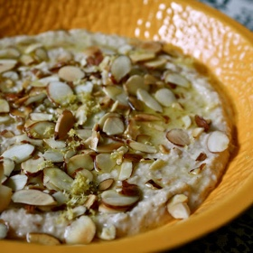

---
categories:
- 9B3E8F54-7F9D-4782-919F-ACC9A0850C87
- F0D08EC3-D9EF-4F02-A381-FF3D38660DA6
- 1C21D75E-3CF2-4B23-B04F-A9275BC1033B
- 088012EF-69C0-412F-BD34-160FE5B0E043
cook_time: ''
created: '2020-03-15 16:22:39'
difficulty: ''
hash: 5489eaf76c97c29d693dbb541ffdb06dd456ac360bfd2b1b0fcd94cd194e3e41
image_url: http://3.bp.blogspot.com/-olWxY1Hoqdo/UCbX2k1YDCI/AAAAAAAAJSA/Ly5_OivkLyI/s640/IMG_4532.JPG
in_trash: false
is_pinned: false
on_favorites: false
on_grocery_list: false
prep_time: ''
rating: 0
scale: null
servings: About 2 cups
source: sparrowsandspatulas.blogspot.com
source_url: http://sparrowsandspatulas.blogspot.com/2012/08/cooking-from-pantry-part-i-heidi.html
total_time: ''
uid: 33B4BBEF-FFDB-41E1-9FEE-95798612A01E-4240-00000175C9036C21
---

# Heidi Swanson's White Bean Dip with Almonds and Rosemary

## Ingredients

- 1/4 cup extra-virgin olive oil
- 1 tsp chopped fresh rosemary
- 1 garlic clove, finely chopped
- 1 (15 oz) can white beans, rinsed and drained (I used Cannellini)
- 3/4 cup sliced almonds, toasted
- Fine-grain sea salt
- 1 tbsp fresh lemon juice, plus more if needed (I used about 1 tsp more)
- 1/4-3/4 cup hot water
- Grated zest of 1/2 lemon

## Directions

In a small saucepan, combine the olive oil, rosemary and garlic. Over medium-low heat, slowly warm the mixture until the oil just barely starts to sizzle, 1-2 minutes. Remove from the heat and set aside for 10 minutes. Pour the oil through a strainer and discard the garlic and rosemary bits.

In a food processor, combine the beans, two-thirds of the almonds, a scant 1/2 tsp salt, the lemon juice, and two-thirds of the rosemary oil. Pulse a couple of times to bring the ingredients together. Add the water 1/4 cup at a time, pulsing all the while, until the mixture is the consistency of thick frosting. You might not need all the water; it really depends on how starchy your beans are and how thick you’d like the spread to be. Taste and adjust with more lemon juice or salt, if needed.

Scoop the spread into a serving dish and make a few indentations in the top. Sprinkle with the lemon zest and the remaining almonds and drizzle with the remaining rosemary oil. Serve with pita chips.

{To toast the almonds: Place the nuts in a single layer in a large, heavy skillet over medium heat. Toss them around every couple of minutes, until fragrant and toasty. Don't walk away; if you do, set a timer so you don't forget. You can burn a batch of nuts very quickly!}
