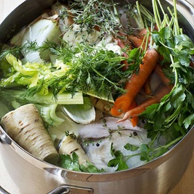

---
categories:
- A3FA97E2-41F7-4C28-8433-211311D4E130
- E131025A-19E9-4C5F-99A8-75EE51F165D8
- 98E4F68D-11D7-4383-90FA-22C804880E1C
cook_time: ''
created: '2021-02-16 08:12:11'
difficulty: ''
hash: 7d0d9d5a5219058b322cb522caa8c7267fc238877de1f2b50edc424dda66b77b
image_url: https://d14iv1hjmfkv57.cloudfront.net/assets/recipes/homemade-chicken-stock/_600x600_crop_center-center_61_line/62.jpg?mtime=20160920132723&focal=none&tmtime=20200930113027
in_trash: false
is_pinned: false
on_favorites: false
on_grocery_list: false
prep_time: ''
rating: 0
scale: null
servings: 6 quarts
source: barefootcontessa.com
source_url: https://barefootcontessa.com/recipes/homemade-chicken-stock
total_time: ''
uid: 79AFCEFB-D8EB-4D11-A472-204B9D40F2D9-10855-00000356D62B18E9
---

# Homemade Chicken Stock

## Ingredients

- 3 (5-lb) roasting chickens
- 3 large yellow onions, unpeeled and quartered
- 6 carrots, unpeeled and halved crosswise
- 4 celery stalks with leaves, cut into thirds crosswise
- 4 parsnips, unpeeled and halved crosswise
- 20 sprigs fresh flat-leaf parsley
- 15 sprigs fresh thyme
- 20 sprigs fresh dill
- 1 head garlic, unpeeled and cut in half crosswise
- 2 tbsp kosher salt
- 2 tsp whole black peppercorns (not ground)

## Directions

Place the chickens, onions, carrots, celery, parsnips, parsley, thyme, dill, garlic, salt, and peppercorns in a 16-20 quart stockpot. Add 7 quarts of water and bring to a boil. Lower the heat and simmer uncovered for 4 hours, skimming off any foam that comes to the top. Set aside until cool enough to handle. Strain the entire contents of the pot through a colander and discard the solids.
