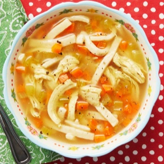

---
categories:
- 135D8DF8-5165-487A-9161-61345003AB1B
- E131025A-19E9-4C5F-99A8-75EE51F165D8
- 460F3A6B-0B87-457B-AF84-A1CE51D92D74
- 98E4F68D-11D7-4383-90FA-22C804880E1C
cook_time: 0 hours
created: '2022-09-25 11:43:17'
difficulty: ''
hash: 2b26b0a659e697921ee683321d612fad35e3b2a0b26beeacbc95c38ace44b992
image_url: https://hips.hearstapps.com/hmg-prod.s3.amazonaws.com/images/homemade-chicken-and-noodles-1597679333.jpg?crop=0.432xw:0.899xh;0.323xw,0.101xh&resize=640:*
in_trash: false
is_pinned: false
on_favorites: false
on_grocery_list: false
prep_time: '10'
rating: 0
scale: null
servings: 'Yields: 6'
source: thepioneerwoman.com
source_url: https://www.thepioneerwoman.com/food-cooking/recipes/a9895/homemade-chicken-and-noodles/
total_time: ''
uid: 30D231F3-2F52-449B-B2A3-9EC8085E9218
---

# Homemade Chicken and Noodles

## Ingredients

- 1 whole cut-up fryer chicken
- 2 whole carrots, diced
- 2 stalks celery, diced
- 1/2 whole medium onion, diced (optional)
- 1 tsp. salt
- 1/2 tsp. turmeric
- 1/4 tsp. white pepper (more to taste)
- 1/4 tsp. ground thyme
- 2 tsp. parsley flakes
- 16 oz. frozen "homemade" egg noodles
- 3 tbsp. all-purpose flour

## Directions

Cover chicken in 4 quarts water. Bring to a boil, then reduce heat to low. Simmer for 30 minutes.

Remove chicken from pot with a slotted spoon. With two forks, remove as much meat from the bones as you can, slightly shredding meat in the process. Return bones to broth and simmer on low, covered, for 45 minutes.

Remove bones from broth with a slotted spoon, making sure to get any small bones that might have detached.

Add the carrots and celery (and onions, if using) to the pot, followed by the herbs and spices. Stir to combine and simmer for ten minutes to meld flavors.

Increase heat and add frozen egg noodles and chicken. Cook for 8 to 10 minutes.

Mix flour and a little water. Stir until smooth. Pour into soup, stir to combine, and simmer for another 5 minutes, or until broth thickens a bit. Test and adjust seasonings as needed.
