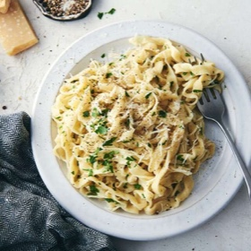

---
categories:
- A3FA97E2-41F7-4C28-8433-211311D4E130
- EAB653D6-0540-48C4-B9D0-FD56AE24841E
cook_time: 35 mins
created: '2022-10-12 12:45:23'
difficulty: ''
hash: 1a5cf2d06282b1b28457c45a021baf7382accaf826089f4534553908a1007737
image_url: https://www.kingarthurbaking.com/sites/default/files/styles/featured_image/public/2020-05/homemade-egg-noodles.jpg?itok=QSlv1m5R
in_trash: false
is_pinned: false
on_favorites: false
on_grocery_list: false
prep_time: 10 mins
rating: 0
scale: null
servings: 4 to 6 servings
source: kingarthurbaking.com
source_url: https://www.kingarthurbaking.com/recipes/homemade-egg-noodles-recipe
total_time: ''
uid: 8EC8F5C4-F6E5-470F-AFD1-55FCDB58BCB3
---

# Homemade Egg Noodles

## Ingredients

- 2 cups (240g) King Arthur Unbleached All-Purpose Flour
- 1 teaspoon salt
- 1 teaspoon baking powder
- 2 large eggs, whisked well
- 1/2 cup (113g) milk

## Directions

Place the flour, salt, and baking powder in the bowl of a food processor and pulse to aerate and combine.

With the machine running, drizzle in the eggs. Process for 20 seconds, or until the mixture looks like fine cornmeal.

Turn the machine on again, and drizzle in the milk. You may not need all of it, so hold back on the last tablespoon or two, adding only if needed to make a smooth, firm dough.

Remove the dough from the processor and knead it briefly by hand to smooth it out. Wrap in plastic wrap, and let sit for 30 to 60 minutes at room temperature. At this point you can place the dough in the fridge for up to 24 hours; longer than that, though, and the dough will oxidize, turning an unattractive gray color.

With a large rolling pin or your pasta machine, roll the pasta about 1/16" thick. Cut long strips 1/2" wide, then cut those strips into 3" pieces. Dust with a touch of extra flour and let dry at room temperature while you bring a large pot of water to a rolling boil.

Drop the noodles into the boiling water by the handful. Be sure to stir the water to keep the strands separated. Cook for 2 to 4 minutes, or until tender. Test a noodle every minute or so until done.

Drain the noodles, and serve them hot, with butter and salt; add pepper and/or herbs, if desired.

Tips from our Bakers

Making chicken soup? Add the fresh, uncooked noodles during the last 5 minutes of cooking time; no need to boil them first.

No food processor? You can also make the noodle dough by hand, in your stand mixer or even on the dough cycle in your bread machine.
