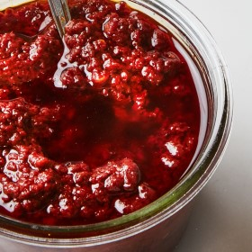

---
categories:
- A3FA97E2-41F7-4C28-8433-211311D4E130
cook_time: ''
created: '2020-10-11 12:24:43'
difficulty: ''
hash: b8adc90d94d9f5f397ef604c6e9295a508e7d5f87070a82ed66f874799618a69
image_url: https://assets.bonappetit.com/photos/58ee9c83ab855168bc0ba4a6/16:9/w_1880,c_limit/three-chile-harissa.jpg
in_trash: false
is_pinned: false
on_favorites: false
on_grocery_list: false
prep_time: ''
rating: 0
scale: null
servings: About 1½ cups
source: Bonappetit.com
source_url: https://www.bonappetit.com/recipe/homemade-harissa
total_time: ''
uid: 86D65850-1C1A-4003-AA56-6A1535A333CF
---

# Homemade Harissa

## Ingredients

- 15 dried chiles de árbol
- 2 dried guajillo chiles
- 1 dried ancho chile
- 1 tbsp cumin seeds
- 1 1/2 tsp coriander seeds
- 3 garlic cloves, smashed
- 2 tbsp fresh lemon juice
- 1 tbsp white wine vinegar
- 1 tbsp tomato paste
- 1 1/2 tsp hot smoked Spanish paprika
- 1 tsp kosher salt
- 3/4 cup olive oil, divided

## Directions

Place árbol, guajillo, and ancho chiles in a large heatproof measuring glass. Pour boiling water over to submerge, cover with plastic wrap, and let sit until chiles are very pliable and cool enough to handle, 15-20 minutes. Drain; remove stems and seeds and discard (wear gloves for this part if you have them).

Toast cumin and coriander in a dry small skillet over medium-low heat, tossing constantly, until very fragrant, about 3 minutes. Transfer to a food processor, add garlic, and pulse until spices are broken up and garlic forms a paste. Add chiles and pulse until chiles form a coarse paste. Add lemon juice, vinegar, tomato paste, paprika, and salt and process until mostly smooth but mixture still has a little texture. With the motor running, stream in 1/2 cup oil. Process until oil is incorporated.

Transfer harissa to a bowl. Pour remaining 1/4 cup oil over top.

Do Ahead: Harissa can be made 1 month ahead. Cover and chill.
