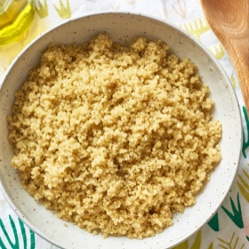

---
categories:
- A3FA97E2-41F7-4C28-8433-211311D4E130
cook_time: 25-30 minutes
created: '2022-07-19 12:35:36'
difficulty: ''
hash: 85f3d7a5ee78b91347361794bdd34757563cc2a9a5186a25c5ac0d0ff97800d4
image_url: https://cdn.apartmenttherapy.info/image/upload/f_auto,q_auto:eco,c_fill,g_center,w_730,h_913/k%2Farchive%2Fd4fc553aa34f8086392b5cd44695759b57b5795d
in_trash: false
is_pinned: false
on_favorites: false
on_grocery_list: false
prep_time: 5 minutes
rating: 0
scale: null
servings: Serves 4-6, makes about 3 cups
source: thekitchn.com
source_url: https://www.thekitchn.com/how-to-cook-quinoa-cooking-lessons-from-the-kitchn-63344
total_time: ''
uid: C3D09721-B363-43B4-A834-284BA15D4D4B
---

# How to Cook Quinoa

## Ingredients

- 1 cup uncooked quinoa (any variety — white or golden, red, or black)
- 1 tsp olive oil
- 1 3/4 cups water or low-sodium broth
- 1/2 tsp kosher salt
- shallots or onion

## Directions

Rinse the quinoa. Place the quinoa in a fine-mesh strainer. Rinse thoroughly under cool, running water. Rub and swish the quinoa with your hand while rinsing. Drain.

Toast the quinoa in a saucepan. Heat the olive oil in a small saucepan over medium-high heat until shimmering. Add the drained quinoa and cook, stirring constantly, to let the water evaporate and toast the quinoa, about 2 minutes.

Add liquid and bring to a boil. Stir in the water or broth and the salt. Bring to a rolling boil.

Lower heat and cook, covered, for 15 minutes. Turn the heat down to the lowest setting. Cover and cook for 15 minutes.

Let stand, covered, for 5 minutes. Remove the pot from heat and let stand for 5 more minutes, covered. Don't peek!

Fluff and eat! Uncover — You should see tiny spirals (the germ) separating from and curling around the quinoa seeds. Fluff the quinoa gently with a fork and serve. If any liquid remains in the bottom of the pan or if the quinoa is still a bit crunchy, return the pot to low heat and cook, covered, for another 5 minutes, until all the water has been absorbed.

## Notes

Storage: Leftover quinoa can be refrigerated in an airtight container for up to 5 days or frozen for up to 2 months.

## Nutritional Information

alcohol-free
egg-free
kidney-friendly
peanut-free
low-potassium
pork-free
pescatarian
gluten-free
tree-nut-free
red-meat-free
dairy-free
low-carb
fish-free
vegetarian
shellfish-free
vegan
sugar-conscious
soy-free
wheat-free
Calories 7
Fat 0.8 g (1.2%)
Saturated 0.1 g (0.5%)
Carbs 0.1 g (0.0%)
Fiber 0.0 g (0.1%)
Sugars 0.0 g
Protein 0.0 g (0.0%)
Sodium 155.7 mg (6.5%)
