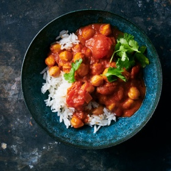

---
categories:
- 135D8DF8-5165-487A-9161-61345003AB1B
- F0D08EC3-D9EF-4F02-A381-FF3D38660DA6
- 641901A6-C962-46DC-B418-1C19B51409EF
- 98E4F68D-11D7-4383-90FA-22C804880E1C
cook_time: 1 hour 10 minutes
created: '2020-08-15 11:09:30'
difficulty: ''
hash: 438c9b244cabd5b5952fe34d8c8f99a97a6900a8b6b714ff5fc76fb464c0bc01
image_url: https://static01.nyt.com/images/2020/01/01/dining/31lessmeat1/merlin_166151946_479509dd-67c1-4c00-9aef-d01504e72355-articleLarge.jpg
in_trash: false
is_pinned: false
on_favorites: false
on_grocery_list: false
prep_time: ''
rating: 0
scale: ''
servings: Yield 4 to 6 servings
source: cooking.nytimes.com
source_url: https://cooking.nytimes.com/recipes/1020739-indian-butter-chickpeas
total_time: ''
uid: 14069927-26C4-4ED1-BEE9-3F14869D3F8F-87110-00002C4CCC786CC7
---

# Indian Butter Chickpeas

## Ingredients

- 4 tablespoons unsalted butter
- 1 large onion, minced
- 1 ½ teaspoons kosher salt, plus more to taste
- 4 garlic cloves, finely grated or minced
- 1 tablespoon grated fresh ginger
- 2 teaspoons ground cumin
- 2 teaspoons sweet paprika
- 2 teaspoons garam masala
- 1 small cinnamon stick
- 1 (28-ounce) can whole peeled plum tomatoes
- 1 (15-ounce) can coconut milk
- 2 (15-ounce) cans chickpeas, drained
- Ground cayenne (optional)
- Cooked white rice, for serving
- ½ cup cilantro leaves and tender stems, for serving

## Directions

Melt butter in a large heavy-bottomed pot or Dutch oven over medium heat. Stir in onion and 1/2 teaspoon salt; cook until golden and browned around the edges, stirring occasionally, about 20 minutes. (Don’t be tempted to turn the heat up to medium-high; keeping the heat on medium ensures even browning without burning the butter.)

Stir in garlic and ginger, and cook another 1 minute. Stir in cumin, paprika, garam masala and cinnamon stick, and cook another 30 seconds.

Add tomatoes with their juices. Using a large spoon or flat spatula, break up and smash the tomatoes in the pot (or you can use a pair of kitchen shears to cut the tomatoes while they are still in the can). Stir in coconut milk and the remaining 1 teaspoon salt. Bring to a simmer, and continue to cook for 10 minutes, stirring occasionally, and continuing to mash up the tomatoes if necessary to help them break down.

Stir in chickpeas and a pinch of cayenne if you like. Bring the pot back up to a simmer and cook, stirring occasionally, for another 10 minutes. Taste and add more salt if necessary.

Serve spooned over white rice, and topped with cilantro.

## Notes

Sub coconut oil for butter for cleaner, less heavy flavor.
