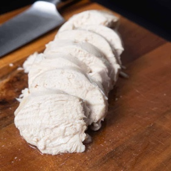

---
categories:
- A3FA97E2-41F7-4C28-8433-211311D4E130
- E131025A-19E9-4C5F-99A8-75EE51F165D8
- 18EDB3A1-512C-4003-8EE4-AE58D58363B1
cook_time: 30 mins
created: '2023-01-26 19:48:59'
difficulty: ''
hash: 7af8aa62ac4cf0f7e098e5d5dc028703513740015e9ee8ed58f6e8890000523d
image_url: https://www.pressurecookrecipes.com/wp-content/uploads/2018/11/instant-pot-chicken-breast.jpg
in_trash: false
is_pinned: false
on_favorites: false
on_grocery_list: false
prep_time: ''
rating: 5
scale: null
servings: Servings 2 - 8
source: pressurecookrecipes.com
source_url: https://www.pressurecookrecipes.com/instant-pot-chicken-breast/#recipe
total_time: ''
uid: 50F308EE-CCCE-4ECC-8B8C-67F725D8D9FB
---

# Instant Pot Chicken Breast

## Ingredients

- 1 - 4 (300g - 1200g) boneless skinless chicken breasts
- 4 cups (1L) cold running tap water
- 1 teaspoon (0.8g) dried oregano
- 1 teaspoon (0.9g) dried rosemary
- 1 teaspoon (1g) dried thyme
- 2 (0.5g) bay leaves
- 5 teaspoons (35g) fine sea salt

## Directions

Add Spice & Salt: Add 5 tsp (35g) fine sea salt, 2 bay leaves, 1 tsp (1g) dried thyme, 1 tsp (0.9g) dried rosemary, and 1 tsp (0.8g) dried oregano to Instant Pot.

*Note: This amount of salt won’t make the chicken breasts too salty. You can skip the salt & spices if you're planning to add your own dressings, spices, or sauces to the chicken breast for salads, sandwiches, or other chicken recipes.

Pour in 4 cups (1L) cold running tap water in Instant Pot.

Pressure Cook Chicken Breast: Add 1 - 4 boneless, skinless chicken breasts in Instant Pot. Pressure Cook at High Pressure for 0 minute (zero minute), then 9 - 12 minutes Natural Release.

For 1 Chicken Breast: Natural Release for 12 minutes

For 2 Chicken Breasts: Natural Release for 11 minutes

For 4 Chicken Breasts: Natural Release for 9 minutes

## Notes

*Note: 0 minute (zero minute) is not a typo! We're using the heat from the "Pressurize" Stage and "Depressurize" Stage to cook the chicken breast in Instant Pot.

Check Chicken Breasts' Internal Temperature: Place chicken breasts on a chopping board, then check internal temperature at its' thickest part with an accurate thermometer.

*Note: The USDA recommends 165°F (74°C) as the safe internal temperature for cooked chicken. If the temperature is off by more than 10°F, quickly place the chicken breasts back in Instant Pot. Close the lid, then let the residual heat in Instant Pot cook the chicken breasts for 1 - 2 more minutes. If not, let the chicken breasts rest until it reaches 165°F (74°C). For Reference, our chicken breasts jumped to 165°F (74°C) after resting for 3 minutes.

Serve: Once the chicken breast has reached 165°F (74°C), slice and serve immediately. You can also shred the chicken breasts, add your favorite dressings, sauces, or seasonings, then serve them in salads, sandwiches, or wraps. Enjoy~

## Nutritional Information

Calories: 190kcal | Carbohydrates: 1g | Protein: 34g | Fat: 4g | Cholesterol: 104mg | Sodium: 214mg | Potassium: 601mg | Vitamin A: 50IU | Vitamin C: 2mg | Calcium: 49mg | Iron: 1.7mg
