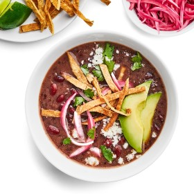

---
categories:
- 135D8DF8-5165-487A-9161-61345003AB1B
- F0D08EC3-D9EF-4F02-A381-FF3D38660DA6
- 1A786DC7-9C26-4F71-B6F4-1B452FC14FB9
- 18EDB3A1-512C-4003-8EE4-AE58D58363B1
cook_time: ''
created: '2020-01-26 10:34:55'
difficulty: ''
hash: cbe7da31cf2478727061b48b2f0aac84b3d7f97874472d66f9553de3553a6f6a
image_url: https://assets.bonappetit.com/photos/5d7bdc893f44610008d75f6e/16:9/w_1880,c_limit/1019-Picky-Eaters-Instant-Pot-Red-Bean-Quinoa-Soup.jpg
in_trash: false
is_pinned: false
on_favorites: false
on_grocery_list: false
prep_time: ''
rating: 0
scale: null
servings: 4–6 servings
source: Bonappetit.com
source_url: https://www.bonappetit.com/recipe/instant-pot-red-bean-and-quinoa-soup-with-taco-fixins
total_time: ''
uid: 63A5B9DB-86D7-4480-8CD0-F4EDE8F346D7
---

# Instant Pot Red Bean and Quinoa Soup with Taco Fixins

## Ingredients

- 2 Tbsp. extra-virgin olive oil
- 1 large red onion, finely chopped
- 4 garlic cloves, finely grated
- 1 Tbsp. ground cumin
- 1 16-oz. package dried Central American red beans, such as Goya or Rancho Gordo Domingo Rojo
- ½ cup red quinoa, rinsed
- 1 Tbsp. sauce from a can of chipotles in adobo
- 2 tsp. kosher salt, plus more
- ½ lime
- To serve:
- ½ small red onion, thinly sliced
- 2 Tbsp. red wine vinegar
- ½ tsp. kosher salt
- ¼ tsp. sugar
- Lime wedges 
- sliced avocado 
- sour cream 
- chopped cilantro 
- crumbled queso fresco or shredded cheddar or Monterey Jack 
- hot sauce, 
- tortilla strips (for serving)

## Directions

Soup

Heat oil in an Instant Pot or other electric pressure cooker on the Sauté setting. Add onion and cook, stirring occasionally, until beginning to turn golden brown around the edges, 6–8 minutes. Add garlic and cumin and cook, stirring constantly, 2 minutes. Add beans, quinoa, adobo sauce, 2 tsp. salt, and 7 cups water. Lock lid and cook soup on high pressure 45 minutes, then release pressure manually. Squeeze in juice from lime half; mix well. Taste and season soup with more salt if needed.

Do Ahead: Soup can be made 2 days ahead. Let cool, then cover and chill. Soup will thicken; add up to 1 cup water before reheating over medium-low.

Assembly

While the soup is cooking, toss onion, vinegar, salt, sugar, and 4 tsp. water in a small bowl to combine. Chill until ready to use.

To serve, ladle soup into bowls and top with pickled onions and other toppings of your choice.

Do Ahead: Onion can be pickled 5 days ahead. Cover and keep chilled.
