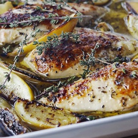

---
categories:
- 135D8DF8-5165-487A-9161-61345003AB1B
- E131025A-19E9-4C5F-99A8-75EE51F165D8
- 1C21D75E-3CF2-4B23-B04F-A9275BC1033B
- 2BBE169B-4709-4377-8F54-765FFAAD9E1A
cook_time: ''
created: '2021-02-15 20:08:10'
difficulty: ''
hash: d1ed013856b3b577590575a0342c96748e32ac411859116eea8915d7ffc0666e
image_url: https://d14iv1hjmfkv57.cloudfront.net/assets/recipes/lemon-chicken-breasts/_600x600_crop_center-center_61_line/Page-121-web-horizon.jpg?mtime=20160727120043&focal=none&tmtime=20200930093634
in_trash: false
is_pinned: false
on_favorites: false
on_grocery_list: false
prep_time: ''
rating: 0
scale: null
servings: Serves 4
source: barefootcontessa.com
source_url: https://barefootcontessa.com/recipes/lemon-chicken-breasts
total_time: ''
uid: 74D49BCA-E957-43B1-96EF-2C127D43FF49-10855-000003446A3F3098
---

# Lemon Chicken Breasts

## Ingredients

- 1/4 cup good olive oil
- 3 tablespoons minced garlic (9 cloves)
- 1/3 cup dry white wine
- 1 tablespoon grated lemon zest (2 lemons)
- 2 tablespoons freshly squeezed lemon juice
- 1½ teaspoons dried oregano
- 1 teaspoon minced fresh thyme leaves
- Kosher salt and freshly ground black pepper
- 4 boneless chicken breasts, skin on (6 to 8 ounces each)
- 1 lemon

## Directions

Preheat the oven to 400 degrees.

Warm the olive oil in a small saucepan over medium-low heat, add the garlic, and cook for just 1 minute but don’t allow the garlic to turn brown. Off the heat, add the white wine, lemon zest, lemon juice, oregano, thyme, and 1 teaspoon salt and pour into a 9 × 12-inch baking dish.

Pat the chicken breasts dry and place them skin side up over the sauce. Brush the chicken breasts with olive oil and sprinkle them liberally with salt and pepper. Cut the lemon in 8 wedges and tuck it among the pieces of chicken.

Bake for 30 to 40 minutes, depending on the size of the chicken breasts, until the chicken is done and the skin is lightly browned. If the chicken isn’t browned enough, put it under the broiler for 2 minutes. Cover the pan tightly with aluminum foil and allow to rest for 10 minutes. Sprinkle with salt and serve hot with the pan juices.
