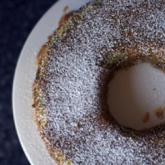

---
categories:
- 6BF378BD-8FD0-4FEF-9755-940308F0C8C7
- 60FB6093-F8C4-447B-A9A2-81A75BBCBA70
- E5311B89-BA3B-4153-9D9E-C809730BC236
- 2BBE169B-4709-4377-8F54-765FFAAD9E1A
cook_time: ''
created: '2020-02-23 09:58:39'
difficulty: ''
hash: 49eafdf43da046328064705f2557f9ca801500e45b9d336460a6ceb770e6f846
image_url: https://smittenkitchendotcom.files.wordpress.com/2015/05/poppy-seed-lemon-cake1.jpg?w=300
in_trash: false
is_pinned: false
on_favorites: false
on_grocery_list: false
prep_time: ''
rating: 0
scale: null
servings: ''
source: smittenkitchen.com
source_url: https://smittenkitchen.com/2010/01/poppy-seed-lemon-cake/
total_time: ''
uid: E428FCB9-9A2B-49FA-863A-31DBB29BB74D-30191-0000166E6422AE4A
---

# Lemon Poppy Seed Cake

## Ingredients

- 2/3 cup sugar
- 8 large egg yolks
- 1 large whole egg
- 1 1/2 tablespoons finely grated lemon zest (from 2 lemons)
- 1/2 cup all-purpose flour
- 1/2 cup cornstarch
- Pinch of salt (edited to add this)
- 2 sticks (1/2 pound) unsalted butter, melted and cooled a bit
- 1/2 cup poppy seeds (I got this from one 3-ounce spice bottle)

## Directions

Preheat the oven to 325°F Butter and flour an 8-inch* fluted Bundt or tube pan generously. (This cake very much wants to stick. Don’t let it!) Butter the dull side of a 10-inch piece of foil.

* I only had a 10-inch and it worked fine; the cake was done about 10 minutes sooner.

In the bowl of an electric mixer fitted with the whisk, beat the sugar with the egg yolks and whole egg at medium-high speed until the mixture is pale yellow and very fluffy, about 8 minutes. Beat in the lemon zest. Sift the flour and cornstarch over the egg mixture and fold in along with the pinch of salt with a rubber spatula. At medium speed, beat in the butter, then beat in the poppy seeds.

Pour the batter into the prepared pan and cover tightly with the buttered foil. Bake for 45 minutes, or until the cake pulls away from the side of the pan and a cake tester inserted in the center of the cake comes out clean. Remove the foil and let the cake cool in the pan on a rack for 15 minutes. Invert the cake onto the rack and let cool completely before serving, at least 30 minutes.

Do ahead: The cake can be wrapped in plastic and foil and left at room temperature for up to 3 days.
