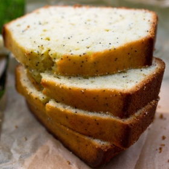

---
categories:
- 6BF378BD-8FD0-4FEF-9755-940308F0C8C7
- 60FB6093-F8C4-447B-A9A2-81A75BBCBA70
- E5311B89-BA3B-4153-9D9E-C809730BC236
- 2BBE169B-4709-4377-8F54-765FFAAD9E1A
cook_time: 1 hour 20 minutes
created: '2020-02-23 10:00:23'
difficulty: ''
hash: 32107319a9cbe8ff0b0f308bdd91a416533cf6a4da9a1204cab41d7914dd97f1
image_url: https://static01.nyt.com/images/2013/06/12/dining/12JPAPPE3/12JPAPPE3-articleLarge.jpg
in_trash: false
is_pinned: false
on_favorites: false
on_grocery_list: false
prep_time: ''
rating: 0
scale: null
servings: Yield 8 servings
source: cooking.nytimes.com
source_url: https://cooking.nytimes.com/recipes/1014800-lemon-poppy-seed-pound-cake
total_time: ''
uid: B97ED440-FDAA-483B-91E8-A047916F61D8-30191-0000166EE1D14FDB
---

# Lemon Poppy Seed Pound Cake

## Ingredients

- Butter, for greasing pan
- 1 ¾ cup all-purpose flour, more for pan
- Zest of 2 lemons
- 1 cup sugar
- ½ cup buttermilk
- 3 tablespoons plus 4 teaspoons lemon juice
- 3 large eggs
- 1 ½ teaspoons baking powder
- ¼ teaspoon baking soda
- ¼ teaspoon fine sea salt
- ⅔ cup extra-virgin olive oil
- 1 tablespoon poppy seeds
- ½ cup confectioners’ sugar

## Directions

Heat oven to 350 degrees. Butter and flour an 8-inch loaf pan.

In a bowl, combine lemon zest and sugar and rub with your fingers until it looks like wet sand. Whisk in buttermilk, 3 tablespoons lemon juice and eggs. In a separate bowl, whisk together flour, baking powder, baking soda and salt. Whisk dry ingredients into the batter, then whisk in oil and poppy seeds.

Pour batter into prepared pan. Bake until a toothpick inserted in the center emerges clean, about 1 hour. Let cool in pan until warm to the touch, then turn out onto a baking rack set over a rimmed baking sheet. Turn cake right side up.

Whisk together remaining 4 teaspoons lemon and the confectioners’ sugar. Use a pastry brush to spread glaze evenly over top and sides of cake. Cool completely before slicing.
