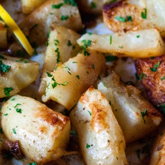

---
categories:
- 9B3E8F54-7F9D-4782-919F-ACC9A0850C87
- 60FB6093-F8C4-447B-A9A2-81A75BBCBA70
- 3C8ADFAF-87C1-4C30-AA13-572072B4B626
- 2BBE169B-4709-4377-8F54-765FFAAD9E1A
cook_time: 1 hour
created: '2021-04-05 13:13:21'
difficulty: ''
hash: 38a3d95d965a58147168f8c4e356039a4cc4eb0467634a0057a72ebda44fe940
image_url: https://i2.wp.com/smittenkitchen.com/wp-content/uploads/2021/04/lemon-potatoes-scaled.jpg?w=1920&ssl=1
in_trash: false
is_pinned: false
on_favorites: false
on_grocery_list: false
prep_time: ''
rating: 0
scale: null
servings: 'Servings: 4 to 6'
source: smittenkitchen.com
source_url: https://smittenkitchen.com/2021/04/lemon-potatoes/
total_time: ''
uid: A9E8CF22-5607-42AD-BA1D-97C54E9D2DCC
---

# Lemon Potatoes

## Ingredients

- 2 pounds yukon gold (ideally) or russet potatoes (see note), peeled and quartered lengthwise into thick wedges
- 4 tablespoons olive oil or 3 tablespoons olive oil plus 1 tablespoon unsalted butter, diced
- 2 teaspoons fresh oregano leaves, minced or 1 teaspoon dried oregano
- 1 teaspoon kosher salt
- Finely grated zest and juice of two lemons (about 1/4 cup juice)
- 1/2 teaspoon freshly ground black pepper
- 3 to 4 garlic cloves, peeled and smashed
- 3/4 cup broth, chicken or vegetable
- Chopped fresh parsley or dill, plus additional lemon slices or wedges, to finish

## Directions

Heat oven to 475°F.

In a 9×13-inch rimmed sheet pan or deeper baking dish (ideally stainless steel, coated, or stoneware, not glass*) toss potatoes with olive oil, oregano, salt, zest, and pepper evenly to coat. If using butter, dot it over. Roast for 15 to 20 minutes, until potatoes are well-browned underneath. Use a thin spatula** to turn potatoes over, sprinkle in garlic cloves, and return to the oven for another 10 to 15 minutes, until mostly browned underneath on the second side. Pour in broth and lemon juice all over and return to the oven a final time for 15 minutes, or until potatoes and garlic cloves are tender and liquids have reduced to a very thin puddle. Let rest for 5 minutes before serving (any remaining liquid will absorb), sprinkle with herbs, and serve with additional lemon wedges.

As a few, sadly, have learned the hard way, glass can break when faced with a big temperature change, such as pouring the cold broth and lemon juice into the very hot pan near the end. If you only have glass to roast in, warm the broth before pouring it in, then, once it’s in, cold or room temperature lemon juice is fine to add next.

this spatula is my forever go-to
