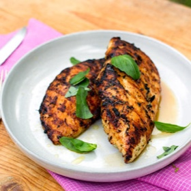

---
categories:
- 135D8DF8-5165-487A-9161-61345003AB1B
- E131025A-19E9-4C5F-99A8-75EE51F165D8
- 1C21D75E-3CF2-4B23-B04F-A9275BC1033B
- 29FDEC25-D5A4-4D29-A800-2D2E46095301
cook_time: ''
created: '2023-07-15 13:31:57'
difficulty: ''
hash: a490406ffe9ced110257dd323625242589d9984e0566d73ac8b135437758b925
image_url: https://static01.nyt.com/images/2015/06/17/multimedia/clark-grilled-chicken/clark-grilled-chicken-mediumThreeByTwo440.jpg
in_trash: false
is_pinned: false
on_favorites: false
on_grocery_list: false
prep_time: ''
rating: 0
scale: null
servings: 4 servings
source: cooking.nytimes.com
source_url: https://cooking.nytimes.com/recipes/1017485-lemon-and-thyme-grilled-chicken-breasts
total_time: 1 hr 30 min
uid: 511746A0-583E-418A-8AA9-5178F5A8194D
---

# Lemon and Thyme Grilled Chicken Breasts

## Ingredients

- 4 (6 oz) boneless, skinless chicken breasts
- 1 1/2 tsp kosher salt
- 1 tsp black pepper
- 2 tbsp chopped thyme leaves
- 4 garlic cloves, crushed and peeled
- 2 lemons, as needed
- 2 tbsp extra-virgin olive oil, more as needed
- Torn basil or mint leaves, as needed

## Directions

Place chicken breasts between two sheets of parchment or plastic wrap. Using a mallet or rolling pin, pound each to an even thickness of 1/2 inch. Do not make them any thinner or they could dry out.

Place chicken in a large bowl and toss with salt, pepper, thyme, garlic and the zest and juice of 1 lemon. Mix in olive oil. Cover and refrigerate 1-2 hours. Remove chicken from fridge while you heat the grill.

Light the grill, building a hot fire, or heat your gas grill to high. Once grill is fully heated, brush breasts lightly with olive oil and place chicken on the grill. Cook until undersides are browned and chicken is about halfway cooked, 3-5 minutes. Flip breasts and grill until cooked through, 3-5 minutes more.

Transfer chicken to a platter. Drizzle with oil and garnish with additional lemon juice, olive oil and basil or mint leaves.

## Nutritional Information

Trans Fat: 0 g
Fat: 11 g
Calories: 280
Saturated Fat: 2 g
Unsaturated Fat: 8 g
Sodium: 490 milligrams
Sugar: 1 g
Fiber: 1 g
Carbohydrate: 4 g
Protein: 39 g
