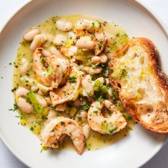

---
categories:
- 135D8DF8-5165-487A-9161-61345003AB1B
- 74D19AD7-7FB6-416E-B539-74DCDC2A820A
- 1A786DC7-9C26-4F71-B6F4-1B452FC14FB9
- 98E4F68D-11D7-4383-90FA-22C804880E1C
cook_time: 30 minutes
created: '2020-02-02 12:04:19'
difficulty: ''
hash: 81ab8bfb84c9cbef17ae6dd3f9caaa8ed483df5139fc8dc689e913cc3a3d2f16
image_url: https://static01.nyt.com/images/2020/01/24/dining/sl-shrimp-and-bean/sl-shrimp-and-bean-articleLarge-v2.jpg
in_trash: false
is_pinned: false
on_favorites: false
on_grocery_list: false
prep_time: ''
rating: 0
scale: null
servings: Yield 4 servings
source: cooking.nytimes.com
source_url: https://cooking.nytimes.com/recipes/1020828-lemony-shrimp-and-bean-stew
total_time: ''
uid: BD0727A7-C461-4C21-93CB-D4CFF63A76C2-10580-0000082A4BED5F7B
---

# Lemony Shrimp and Bean Stew

## Ingredients

- 1 teaspoon fresh lemon zest, plus 2 tablespoons juice
- 1 teaspoon sweet paprika
- 2 garlic cloves, grated
- Kosher salt and black pepper
- 1 pound peeled, deveined large shrimp (tails removed)
- 4 tablespoons unsalted butter (1/2 stick)
- 2 large leeks, trimmed, then halved lengthwise, white and light green parts sliced crosswise 1/2-inch thick
- 1 (15-ounce) can cannellini beans, rinsed
- 2 cups chicken broth
- 2 tablespoons finely chopped fresh parsley
- Toasted bread, for serving

## Directions

Combine lemon zest, paprika, garlic, 3/4 teaspoon salt and 3/4 teaspoon pepper in a medium bowl. Add shrimp and toss to coat.

In a large pot, melt butter over medium-high heat. When butter is foaming, add shrimp and cook, stirring occasionally, until pink and starting to curl, 2 to 3 minutes. Using a slotted spoon, transfer shrimp to a plate; set aside.

Add leeks, season with salt and pepper, and cook over medium until leeks are soft and starting to brown on the edges, 4 to 5 minutes, stirring occasionally. Add beans and chicken broth and bring to a boil over high. Lower heat and simmer, 8 to 10 minutes. Stir in reserved shrimp and any juices from the plate, parsley and lemon juice, and season with salt and pepper. Serve with toasted bread.

## Nutritional Information

Calories: 389
Total Carbohydrates: 37 grams
Cholesterol: 176 milligrams
Total Fat: 14 grams
Dietary fiber: 7 grams
Protein: 27 grams
Saturated fat: 8 grams
Sodium: 972 milligrams
Trans Fat: 0 grams
