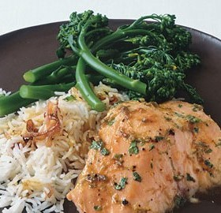

---
categories:
- 135D8DF8-5165-487A-9161-61345003AB1B
- 0E6E410A-45EC-4274-98C8-2190B87DB54A
- 3C8ADFAF-87C1-4C30-AA13-572072B4B626
- 2BBE169B-4709-4377-8F54-765FFAAD9E1A
cook_time: 55 min
created: '2020-01-26 10:34:14'
difficulty: ''
hash: 121afb16ccb5fdbe36a789455c01db57f27972974484a4ae386739e61ed22739
image_url: https://assets.bonappetit.com/photos/57b04e7853e63daf11a4ea1b/16:9/w_1880,c_limit/mare_lime_and_honey_glazed_salmon_with_basmati_and_broccolini_h.jpg
in_trash: false
is_pinned: false
on_favorites: false
on_grocery_list: false
prep_time: 35 min
rating: 0
scale: null
servings: 4 servings
source: Bonappetit.com
source_url: https://www.bonappetit.com/recipe/lime-and-honey-glazed-salmon-with-basmati-and-broccolini
total_time: ''
uid: B172CD22-8DBC-4A35-AA81-6A596FBC3F4B
---

# Lime- And Honey-Glazed Salmon with Basmati and Broccolini

## Ingredients

- 1/4 cup fresh lime juice
- 2 tablespoons finely grated lime peel
- 2 tablespoons honey
- 2 tablespoons chopped fresh cilantro plus additional for sprinkling
- 4 teaspoons soy sauce
- 1 tablespoon olive oil
- 3/4 cup sliced shallots (about 3 large)
- 1 1/2 cups basmati rice (9 to 10 ounces)
- 3 1/4 cups (or more) low-salt chicken broth
- 4 5- to 6-ounce skinless salmon fillets
- 1 bunch broccolini, bottom inch trimmed, stalks separated if necessary

## Directions

Preheat oven to 450°F. Whisk lime juice, lime peel, honey, 2 tablespoons cilantro, and soy sauce in small bowl; set aside.

Heat oil in large deep ovenproof skillet or casserole (with lid) over medium-high heat. Add shallots and sauté until beginning to soften and brown, about 5 minutes. Stir in rice, then 3 1/4 cups broth; bring to boil. Cover skillet tightly with lid; place in oven and bake 10 minutes (rice will be almost cooked through and most of broth will be absorbed; mix in more broth by 1/4 cupfuls if dry).

Remove skillet from oven. Sprinkle rice lightly with salt. Sprinkle salmon with salt and pepper and arrange on rice, pressing in lightly. Tuck broccolini in around fish, with stems anchored in rice. Spoon 1 tablespoon lime mixture over each salmon fillet. Cover skillet tightly and return to oven; bake until salmon is just opaque in center and broccolini is crisp-tender, 8 to 10 minutes. Drizzle remaining lime mixture over fish and rice; sprinkle with additional chopped cilantro and serve from skillet.
