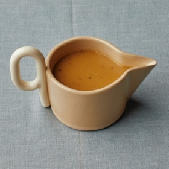

---
categories:
- A3FA97E2-41F7-4C28-8433-211311D4E130
- E131025A-19E9-4C5F-99A8-75EE51F165D8
- 98E4F68D-11D7-4383-90FA-22C804880E1C
cook_time: ''
created: '2023-11-22 16:22:52'
difficulty: ''
hash: 08f90325f3e4c867e2d8a94854f415f801693d6e3f2a8476cdb3e4e5b9ac0ba7
image_url: https://assets.bonappetit.com/photos/6526bb622eedd20d811b45b8/1:1/w_2560%2Cc_limit/20230823-1123-THANKSGIVING-WELL-1326.jpg
in_trash: false
is_pinned: false
on_favorites: false
on_grocery_list: false
prep_time: ''
rating: 0
scale: null
servings: 8 servings
source: bonappetit.com
source_url: https://www.bonappetit.com/recipe/make-ahead-gravy
total_time: ''
uid: 9F2E1458-1F8F-4560-A0E4-82B3EC5AE46D
---

# Make-Ahead Gravy

## Ingredients

- 1 Tbsp. vegetable oil
- 1 lb. chicken wings
- 1 large onion, unpeeled, coarsely chopped
- 1 large carrot, peeled, coarsely chopped
- 1 celery stalk, coarsely chopped
- A small handful of rosemary, thyme, and/or bay leaves
- 1 cup dry white wine
- 6 cups (or more) Thanksgiving Stock or low-sodium chicken broth
- 3 Tbsp. unsalted butter
- ¼ cup Wondra or all-purpose flour
- ½ tsp. Worcestershire sauce
- Kosher salt, freshly ground pepper

## Directions

Heat 1 Tbsp. vegetable oil in a large saucepan over medium-high. Cook 1 lb. chicken wings, turning occasionally, until golden brown, 10–12 minutes. Add 1 large onion, unpeeled, coarsely chopped, 1 large carrot, peeled, coarsely chopped, and 1 celery stalk, coarsely chopped, and cook, stirring and turning wings often, until everything in pan is deeply browned, 14–16 minutes. Add a small handful of rosemary, thyme, and/or bay leaves and cook, stirring, until fragrant, about 1 minute. Pour in 1 cup dry white wine and use a wooden spoon to scrape up any browned bits stuck to the bottom of pan. Bring to a boil and cook until wine is reduced by half, about 5 minutes. Add 6 cups Thanksgiving Stock or low-sodium chicken broth and return to a boil. Reduce heat and simmer, stirring occasionally, until liquid is reduced by a third, 35–40 minutes.

Strain fortified stock through a fine-mesh sieve into a heatproof bowl. (You should have about 4 cups. If you don’t, add enough stock or water to get you there.) Discard solids. Keep fortified stock warm while you make your roux.

Heat 3 Tbsp. unsalted butter in a medium saucepan over medium. Whisk in ¼ cup Wondra or all-purpose flour and cook, whisking constantly, until roux is golden brown and looks smooth and shiny, about 4 minutes.

Whisking constantly, ladle fortified stock into roux, pouring in gradually and making sure to incorporate after each addition before adding more. Simmer, whisking often, until gravy is thickened and reduced to about 3 cups (it should coat a spoon), 8–10 minutes. Stir in ½ tsp. Worcestershire sauce, taste, and season with kosher salt and freshly ground pepper.Do Ahead: Gravy can be made 5 days ahead. Let cool; cover and chill. Reheat over low before serving.Editor’s note: This Make-Ahead Gravy recipe was first printed in our November 2017 issue. Head this way for more of our best Thanksgiving recipes →
