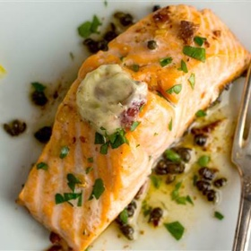

---
categories:
- 135D8DF8-5165-487A-9161-61345003AB1B
- 0E6E410A-45EC-4274-98C8-2190B87DB54A
- 1C21D75E-3CF2-4B23-B04F-A9275BC1033B
- 2BBE169B-4709-4377-8F54-765FFAAD9E1A
cook_time: 25 minutes
created: '2020-03-21 19:56:39'
difficulty: ''
hash: 13759ed41315d569c646aa8b8d5f8530ba82df0319deb9a2d8fbf0ddee324999
image_url: https://media2.s-nbcnews.com/j/newscms/2019_46/1506800/melissa-clark-oven-salmon-today-main-191113_b73818359315537ab9e21ab4f2be49a6.today-inline-small2x.jpg
in_trash: false
is_pinned: false
on_favorites: false
on_grocery_list: false
prep_time: ''
rating: 0
scale: null
servings: 'Servings: 4'
source: today.com
source_url: https://www.today.com/recipes/melissa-clark-s-salmon-anchovy-garlic-butter-t167098
total_time: ''
uid: FAFD9EAC-7426-4954-9132-21406806BE9F-59616-0000294318083D03
---

# Melissa Clark's Salmon with Anchovy-Garlic Butter

## Ingredients

- 3 tablespoons unsalted butter, softened
- 4 anchovy fillets, minced
- 1 fat garlic clove, minced (or 2 small ones)
- 1/2 teaspoon coarse kosher salt
- Freshly ground black pepper
- 4 (6- to 8-ounce) skin-on salmon fillets
- 2 tablespoons drained capers, patted dry
- 1/2 lemon
- Fresh chopped parsley, for serving

## Directions

Heat oven to 400 degrees. In a small bowl, mash together butter, anchovies, garlic, salt and pepper.

In a large ovenproof skillet, melt about half the anchovy butter. Add fish, skin side down. Cook for 3 minutes over high heat to brown the skin, spooning some pan drippings over the top of the fish as it cooks. Add capers to bottom of pan and transfer to oven. Roast until fish is just cooked through, 8 to 10 minutes.

Remove pan from oven and add remaining anchovy butter to pan to melt. Place salmon on plates and spoon buttery pan sauce over the top. Squeeze the lemon half over the salmon and garnish with chopped parsley. Serve.
