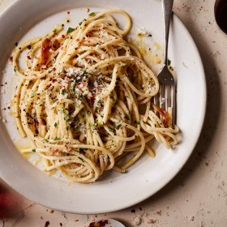

---
categories:
- 135D8DF8-5165-487A-9161-61345003AB1B
- 60FB6093-F8C4-447B-A9A2-81A75BBCBA70
- 460F3A6B-0B87-457B-AF84-A1CE51D92D74
- 2BBE169B-4709-4377-8F54-765FFAAD9E1A
cook_time: 1 hour
created: '2021-01-08 22:34:12'
difficulty: ''
hash: 94593cc37eee5c05da9b2310d82d06478365eb3b048dd895460e608e4931194c
image_url: https://static01.nyt.com/images/2019/11/25/dining/as-Pasta-With-Caramelized-Garlic--Olive-Oil-and-Chile/merlin_161591019_30ca057a-225a-4635-a0ba-059da1d10806-articleLarge.jpg
in_trash: false
is_pinned: false
on_favorites: false
on_grocery_list: false
prep_time: ''
rating: 0
scale: null
servings: Yield 4 servings
source: Cooking.nytimes.com
source_url: https://cooking.nytimes.com/recipes/1020668-midnight-pasta-with-roasted-garlic-olive-oil-and-chile?smid=ck-recipe-android-share
total_time: ''
uid: 450B3360-350D-4015-83D7-7784237C7095
---

# Midnight Pasta with Roasted Garlic, Olive Oil and Chile

## Ingredients

- 1 large head of garlic
- Kosher salt
- 1/2 cup plus 1 tsp extra-virgin olive oil
- 1 cup firmly packed parsley leaves
- 1 lb spaghetti or other long pasta
- 1/2 tsp red-pepper flakes, plus more for garnish
- Black pepper
- Freshly grated Parmesan, for serving

## Directions

Heat the oven to 400°F. Cut off the top 1/4 inch of the head of garlic to expose the top of the cloves, then place on a piece of foil, cut-side up. Sprinkle exposed cloves with salt, then drizzle with 1 tsp oil. Wrap the garlic in the foil and roast until soft and golden brown, 40-50 minutes.

When you’re ready to make the pasta, bring a large pot of salted water to a boil. Finely chop the parsley leaves. Add pasta to the boiling water and cook according to package instructions until al dente. Reserve 1 cup of the pasta water, then drain the pasta.

While the pasta cooks, in a large Dutch oven or skillet, heat the remaining 1/2 cup oil over medium heat. Squeeze the roasted garlic cloves into the oil and cook, breaking them up with your spoon, until very fragrant, 2-3 minutes. Add the red-pepper flakes and a few generous grinds of pepper. Remove the pan from the heat to infuse the oil while the pasta finishes cooking.

When the pasta’s done, heat the garlic oil over medium, then add the cooked pasta, 1/2 cup reserved pasta water and the parsley, and simmer, tossing constantly and adding more pasta water as needed, until the pasta is glossed with sauce.

Serve with more red-pepper flakes, black pepper and Parmesan.
