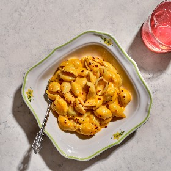

---
categories:
- 135D8DF8-5165-487A-9161-61345003AB1B
- 60FB6093-F8C4-447B-A9A2-81A75BBCBA70
- 460F3A6B-0B87-457B-AF84-A1CE51D92D74
- 2BBE169B-4709-4377-8F54-765FFAAD9E1A
cook_time: ''
created: '2022-11-19 08:14:32'
difficulty: ''
hash: e9887ba64add4ce9e1c6da6a63a919f85f7f6ebf646e12760346d7926ae5f024
image_url: https://assets.bonappetit.com/photos/6318d732b5baa4714d0513c7/1:1/w_2560%2Cc_limit/220628_GuangXu_BA_Supperland_MisoMacCheese_095.jpg
in_trash: false
is_pinned: false
on_favorites: false
on_grocery_list: false
prep_time: ''
rating: 0
scale: null
servings: 4 servings
source: Bonappetit.com
source_url: https://www.bonappetit.com/recipe/miso-macaroni-and-cheese-recipe
total_time: ''
uid: 2D95ADE7-4667-47E9-8301-B3CBD0E74777
---

# Miso Macaroni and Cheese

## Ingredients

- 12 oz. conchigliette (small shells)
- 1½ tsp. Diamond Crystal or 1 tsp. Morton kosher salt, plus more
- 3 cups whole milk
- 2 Tbsp. white miso
- 1 tsp. garlic powder
- ½ tsp. freshly ground black pepper
- ½ tsp. crushed red pepper flakes, plus more for serving
- 4 Tbsp. unsalted butter
- ½ cup (63 g) all-purpose flour
- 8 oz. sharp yellow cheddar, coarsely grated

## Directions

Cook 12 oz. conchigliette (small shells) in a large pot of boiling salted water, stirring occasionally, until al dente. Drain, reserving 1 cup pasta cooking liquid (do not rinse pasta). Spread pasta out on a rimmed baking sheet and set aside.

Whisk 3 cups whole milk, 2 Tbsp. white miso, 1 tsp. garlic powder, ½ tsp. freshly ground black pepper, 1½ tsp. Diamond Crystal or 1 tsp. Morton kosher salt, and ½ tsp. crushed red pepper flakes in a small saucepan to combine, then bring to a simmer over medium-high heat.

Meanwhile, melt 4 Tbsp. unsalted butter in a large pot over medium-low heat. Sprinkle ½ cup (63 g) all-purpose flour over and cook, whisking constantly, until combined and mixture is foaming but still very pale, about 4 minutes.

Whisking constantly to prevent lumps from forming, very gradually pour in 1¼ cups hot milk mixture, then cook, still whisking constantly, until smooth. Add remaining milk mixture and whisk again until smooth. Add 8 oz. sharp yellow cheddar, coarsely grated, and ½ cup pasta cooking liquid and cook, whisking, until cheese is melted and sauce is smooth once more. Add reserved pasta and stir, adding more pasta cooking liquid to loosen sauce if needed, until pasta is well coated.

Transfer macaroni and cheese to a large shallow bowl or dish and sprinkle with more crushed red pepper flakes.
