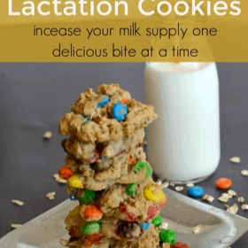

---
categories:
- 6BF378BD-8FD0-4FEF-9755-940308F0C8C7
- 60FB6093-F8C4-447B-A9A2-81A75BBCBA70
- E5311B89-BA3B-4153-9D9E-C809730BC236
- 2BBE169B-4709-4377-8F54-765FFAAD9E1A
cook_time: 20 minutes
created: '2021-06-19 09:36:24'
difficulty: ''
hash: e3ba44b1fe30a4e119080756c495fd397c38d84dfb24e5a4f5533a296e50ca97
image_url: https://thriftyniftymommy.com/wp-content/uploads/2016/07/Lactation-cookie-recipe.png.webp
in_trash: false
is_pinned: false
on_favorites: false
on_grocery_list: false
prep_time: 10 minutes cook time
rating: 0
scale: null
servings: 'Yield: 3-4 dozen cookies'
source: thriftyniftymommy.com
source_url: https://thriftyniftymommy.com/chocolate-lovers-lactation-cookies-recipe/
total_time: ''
uid: D1693469-FF6C-4FD3-A8B2-158BB87B9CE0
---

# Oatmeal Chocolate Chip Lactation Cookies

## Ingredients

- 2 tablespoons ground flax seed
- 1/4 cup water
- 1 cup butter
- 1/2 cup white sugar
- 3/4 cup brown sugar
- 3 eggs
- 2 teaspoons vanilla extract
- 2 cups flour
- 1/4 cup brewer’s yeast
- 1 teaspoon baking soda
- 1/2 teaspoon salt
- 3 cups old fashioned oats
- 2 cups M&Ms or chocolate chips, or a combination of both

## Directions

Preheat oven to 350 degrees.

Mix water and flaxseed together in a small bowl and set aside.

Cream together butter, white sugar, and brown sugar.

Add eggs and vanilla extract and mix until well blended.

Mix in the bowl of flaxseed meal.

Add flour, brewer’s yeast, baking soda, and salt.

Stir in oats and M&Ms/chocolate chips.

Place spoonfuls of the dough onto your baking sheet and bake for about 10 – 13 minutes. I found that in my oven 11 minutes was just perfect.

After taking the cookies out of the oven, let them sit for about a minute or two, and then move them onto a wire rack to cool.

Increase your milk supply while you enjoy delicious cookies!

## Nutritional Information

TOTAL FAT: 14g SATURATED FAT: 8g
TRANS FAT: 0g UNSATURATED FAT: 5g
CHOLESTEROL: 46mg SODIUM: 181mg
CARBOHYDRATES: 39g FIBER: 3g
SUGAR: 22g PROTEIN: 5g
