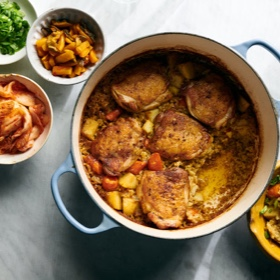

---
categories:
- 135D8DF8-5165-487A-9161-61345003AB1B
- E131025A-19E9-4C5F-99A8-75EE51F165D8
- 641901A6-C962-46DC-B418-1C19B51409EF
- 2BBE169B-4709-4377-8F54-765FFAAD9E1A
cook_time: 1 hour
created: '2020-08-15 11:05:04'
difficulty: ''
hash: d806bb903e6dc88da140599d913d4380afd5db6a047442664a31676a21203575
image_url: https://static01.nyt.com/images/2020/06/24/dining/kc-japanese-curry-chicken/kc-japanese-curry-chicken-articleLarge.jpg
in_trash: false
is_pinned: false
on_favorites: false
on_grocery_list: false
prep_time: ''
rating: 0
scale: null
servings: Yield 4 servings
source: cooking.nytimes.com
source_url: https://cooking.nytimes.com/recipes/1021201-one-pot-japanese-curry-chicken-and-rice
total_time: ''
uid: FCB5CFEC-CB88-458E-B87E-CD32305ABE09-87110-00002C4B49EF262C
---

# One-Pot Japanese Curry Chicken and Rice

## Ingredients

- 2 pounds bone-in, skin-on chicken thighs (about 6 large thighs)
- 2 tablespoons canola oil
- Kosher salt and black pepper
- 3 tablespoons unsalted butter
- ½ cup finely chopped white or yellow onion
- 3 tablespoons Madras curry powder
- 1 tablespoon minced garlic
- 1 tablespoon minced fresh ginger
- ¾ teaspoon ground nutmeg
- 1 ½ cups short-grain white rice, rinsed until water runs clear
- 1 large baking potato (about 1 pound), such as russets, white or Idaho, peeled and cut into 1/2-inch cubes (about 1 1/2 cups)
- 3 medium carrots, sliced 1/2-inch-thick (1 1/2 cups)
- 3 ½ cups low-sodium chicken broth
- 2 tablespoons Worcestershire sauce
- Chopped scallions, pickles, kimchi and/or hot sauce, for serving

## Directions

Heat oven to 375 degrees. Rub chicken with 1 tablespoon oil, and season with salt and pepper.

In a large Dutch oven or heavy pot, heat remaining 1 tablespoon oil with 1 tablespoon butter over medium until butter is melted. Working in two batches, brown chicken 3 to 4 minutes per side, and transfer to a plate.

Add onion to the pot, season with salt and pepper and cook, stirring, until softened, 2 minutes. Add curry powder, garlic, ginger, nutmeg and the remaining 2 tablespoons butter, and stir until butter is melted and spices are fragrant, 1 minute.

Add rinsed rice and stir until evenly coated in spices. Add potato, carrots, broth and Worcestershire sauce, scraping bottom of pot to lift up any browned bits. Season broth generously with salt and pepper. Arrange chicken (and any accumulated juices) on top, skin-side up, and bring to a boil over high. Cover and bake for 20 minutes. Uncover and bake until most of the liquid is absorbed and chicken is golden and cooked through, about 10 minutes longer.

Divide chicken and rice among bowls, and garnish with scallions. Serve with any combination of pickles, kimchi and hot sauce.
