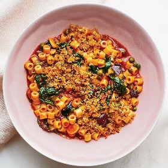

---
categories:
- 135D8DF8-5165-487A-9161-61345003AB1B
- 60FB6093-F8C4-447B-A9A2-81A75BBCBA70
- 460F3A6B-0B87-457B-AF84-A1CE51D92D74
- 98E4F68D-11D7-4383-90FA-22C804880E1C
cook_time: ''
created: '2022-02-08 21:08:14'
difficulty: ''
hash: eadfb0b232681bb50fb8d78efe06a1d61161bec37150935f101555f2038b8e1f
image_url: https://assets.bonappetit.com/photos/61f7f1b95851a853ef804dbe/1:1/w_2560%2Cc_limit/puttanesca.jpg
in_trash: false
is_pinned: false
on_favorites: false
on_grocery_list: false
prep_time: ''
rating: 0
scale: null
servings: 4 servings
source: Bonappetit.com
source_url: https://www.bonappetit.com/recipe/weeknight-puttanesca?utm_campaign=likeshopme&client_service_id=31198&utm_social_type=owned&utm_brand=ba&service_user_id=1.78e+16&utm_content=instagram-bio-link&utm_source=instagram&utm_medium=social&client_service_name=bonappetitmag&supported_service_name=instagram_publishing
total_time: ''
uid: 298EC636-5FCA-4ACD-B1B4-4323855B0E88
---

# One-Pot Puttanesca

## Ingredients

- 6 garlic cloves, thinly sliced
- 4 oil-packed anchovy fillets, divided
- 1/3 cup plus 2 tbsp extra-virgin olive oil
- 1/2 cup Kalamata olives, coarsely chopped
- 6 tbsp double-concentrated tomato paste
- 3 tbsp drained capers
- 1/2 tsp Diamond Crystal or 1/4 tsp Morton kosher salt, plus more
- 1/4 tsp crushed red pepper flakes, plus more for panko
- 8 oz small pasta (such as ditalini, orzo, or mini shells; about 1 1/2 cups)
- 5 oz baby spinach (about 4 1/2 cups)
- 1/2 cup panko

## Directions

Cook garlic, 2 anchovies, and 1/3 cup oil in a medium Dutch oven or other heavy pot over medium heat, stirring and smashing anchovies with a wooden spoon, until garlic starts to brown around the edges, about 3 minutes. Add olives, tomato paste, capers, 1/2 tsp Diamond Crystal or 1/4 tsp Morton kosher salt, and 1/4 tsp red pepper flakes and cook, stirring, until tomato paste turns a shade darker, about 3 minutes.

Add 4 cups water to pot, increase temperature to high, and bring to a boil. Add pasta and spinach, tearing leaves into smaller pieces as you go. Stir to combine, then reduce heat to medium and simmer, stirring often to keep pasta from sticking, until cooked through, 10-12 minutes.

Meanwhile, heat remaining 2 anchovies and 2 tbsp oil in a medium skillet over medium. Add panko and a pinch of red pepper flakes and salt and cook, stirring often and breaking anchovies apart, until golden brown, about 2 minutes.

Divide pasta among bowls and top with panko mixture.
