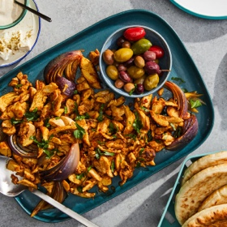

---
categories:
- 135D8DF8-5165-487A-9161-61345003AB1B
- E131025A-19E9-4C5F-99A8-75EE51F165D8
- BA747AF5-0E8E-4B51-BE59-2916BD3A58D4
- 2BBE169B-4709-4377-8F54-765FFAAD9E1A
cook_time: ''
created: '2024-03-31 10:31:39'
difficulty: ''
hash: e35b2dbd4ad5c9c177966ea7a92363a6ca060e2d895b800d8818410ef3c5cc12
image_url: https://static01.nyt.com/images/2023/03/19/multimedia/SS-Oven-Roasted-Chicken-Shawarma-phmt/SS-Oven-Roasted-Chicken-Shawarma-phmt-square640.jpg
in_trash: false
is_pinned: false
on_favorites: false
on_grocery_list: false
prep_time: ''
rating: 0
scale: null
servings: 4-6 servings
source: cooking.nytimes.com
source_url: https://cooking.nytimes.com/recipes/1017161-oven-roasted-chicken-shawarma?smid=tw-nytfood&smtyp=cur&ds_c=71700000052595478&site=google&network=g&campaign_id=1400169272&gad_source=1&gbraid=0AAAAADwd30j-BsR0nxS0PgEuSKmr3OjIx&gclid=EAIaIQobChMIpfOVz9uehQMVcUlHAR17-wpnEAAYASAAEgIf5fD_BwE&gclsrc=aw.ds
total_time: 45 min
uid: 2E7D2979-1880-49E7-85C7-8E0D1008E5E9
---

# Oven-Roasted Chicken Shawarma

## Ingredients

- 2 lemons, juiced
- 1/2 cup plus 1 tbsp olive oil
- 6 garlic cloves, peeled, smashed and minced
- 1 tsp kosher salt
- 2 tsp freshly ground black pepper
- 2 tsp ground cumin
- 2 tsp paprika
- 1/2 tsp turmeric
- A pinch ground cinnamon
- Crushed red pepper, to taste
- 2 lb boneless, skinless chicken thighs
- 1 large red onion, peeled and quartered
- 2 tbsp chopped fresh parsley

## Directions

Prepare a marinade for the chicken. Combine the lemon juice, 1/2 cup olive oil, garlic, salt, pepper, cumin, paprika, turmeric, cinnamon and crushed red pepper in a large bowl, then whisk to combine. Add the chicken and toss well to coat. Cover and store in refrigerator for at least 1 hour and up to 12 hours.

When ready to cook, heat oven to 425°F. Use the remaining tbsp of olive oil to grease a rimmed sheet pan. Add the quartered onion to the chicken and marinade, and toss once to combine. Remove the chicken and onion from the marinade, and place on the pan, spreading everything evenly across it.

Put the chicken in the oven and roast until it is browned, crisp at the edges and cooked through, about 30-40 minutes. Remove from the oven, allow to rest 2 minutes, then slice into bits. (To make the chicken even more crisp, set a large pan over high heat, add a tbsp of olive oil to the pan, then the sliced chicken, and sauté until everything curls tight in the heat.)

Scatter the parsley over the top and serve with tomatoes, cucumbers, pita, white sauce, hot sauce, olives, fried eggplant, feta, rice — really anything you desire.

## Nutritional Information

Trans Fat: 0 g
Fat: 27 g
Calories: 390
Saturated Fat: 5 g
Unsaturated Fat: 21 g
Sodium: 462 milligrams
Sugar: 2 g
Fiber: 2 g
Carbohydrate: 7 g
Protein: 31 g
