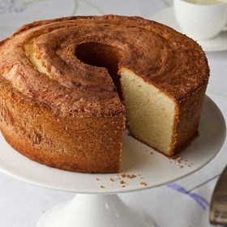

---
categories:
- 6BF378BD-8FD0-4FEF-9755-940308F0C8C7
- 60FB6093-F8C4-447B-A9A2-81A75BBCBA70
- E5311B89-BA3B-4153-9D9E-C809730BC236
- 2BBE169B-4709-4377-8F54-765FFAAD9E1A
cook_time: ''
created: '2021-02-15 20:01:48'
difficulty: ''
hash: f2d608c4c1ec5bbfe1362d96e5009eb1dedd1e05452a3ed514baddfa028648dc
image_url: https://d14iv1hjmfkv57.cloudfront.net/assets/recipes/perfect-pound-cake/_600x600_crop_center-center_61_line/Page-209-web-horizon.jpg?mtime=20160815121308&focal=none&tmtime=20200930103326
in_trash: false
is_pinned: false
on_favorites: false
on_grocery_list: false
prep_time: ''
rating: 0
scale: null
servings: Serves 12
source: barefootcontessa.com
source_url: https://barefootcontessa.com/recipes/perfect-pound-cake
total_time: ''
uid: 19B111C2-9727-4D7C-B831-37C334D1F0C3-10855-000003424900C4F6
---

# Perfect Pound Cake

## Ingredients

- Baking spray with flour, such as Baker’s Joy
- 1/4 cup demerara or turbinado sugar
- 3 cups sifted cake flour
- 1 tsp kosher salt
- 1/2 lb (2 sticks) unsalted butter, at room temperature
- 2 1/2 cups granulated sugar
- 6 extra-large eggs, at room temperature
- 2 tsp pure vanilla extract
- Seeds of 1 vanilla bean
- 2 tsp grated orange zest (2 oranges)
- 1 cup heavy cream

## Directions

DO NOT preheat the oven. Place a rack in the oven so the cake will sit in the center. Generously spray a 12-cup tube pan (not one with a removable bottom!) or two loaf pans (8 1/2 x 4 1/2 x 2 1/2 inches) with the baking spray to coat evenly. Sprinkle with the demerara sugar, tilting the pan or pans to make an even coating of the sugar over the bottom and sides. Set aside.

Combine the sifted cake flour and salt and pass the mixture through a sieve or a sifter from one bowl into another THREE times. Set aside.

In the bowl of an electric mixer fitted with the paddle attachment, beat the butter and granulated sugar on medium speed for 5 minutes, until the mixture is light yellow and fluffy. With the mixer on medium-low, add the eggs one at a time, mixing well after each addition. Mix in the vanilla extract, vanilla seeds, and orange zest. With the mixer on low, add the flour mixture in thirds alternately with the cream, beginning and ending with flour and scraping down the sides of the bowl to combine. (Don’t worry if it looks a little curdled.) Increase the speed to medium and beat for 3 minutes. The batter should be very light and fluffy.

Pour the batter into the prepared pans, smooth the top, and place in the cold oven. Turn the oven to 350°F and bake for 50-55 minutes, until a toothpick comes out clean. Cool in the pan for 30 minutes, carefully remove the cake to a baking rack, rounded side up, and allow to cool completely.
