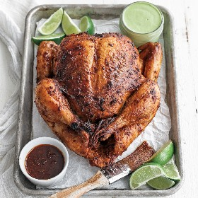

---
categories:
- 135D8DF8-5165-487A-9161-61345003AB1B
- E131025A-19E9-4C5F-99A8-75EE51F165D8
- 1C21D75E-3CF2-4B23-B04F-A9275BC1033B
- 2BBE169B-4709-4377-8F54-765FFAAD9E1A
cook_time: 1 hour 15 minutes
created: '2024-06-16 09:47:51'
difficulty: ''
hash: 3629c01364805c741657bbc5b4613fd8455f4b6d71f6ffc66ff1e1d993fe09d1
image_url: https://www.billyparisi.com/wp-content/uploads/2024/04/peruvian-chicken-1.jpg
in_trash: false
is_pinned: false
on_favorites: false
on_grocery_list: false
prep_time: 20 minutes
rating: 0
scale: null
servings: 'Servings: 4'
source: Billyparisi.com
source_url: https://www.billyparisi.com/peruvian-chicken/#recipe
total_time: ''
uid: C743ECED-A07B-4C7F-A126-C61EB7EAE772
---

# Peruvian Chicken Recipe (Pollo a La Brasa)

## Ingredients

- 1 whole chicken, 3 1/2-4 lb
- 1 tsp cumin seeds
- 1 tsp coriander seeds
- 12 garlic cloves
- 1/2 ” peeled chunk of fresh ginger
- 1 tbsp finely minced fresh rosemary
- 1 tbsp huacatay, or 3-4 fresh mint leaves
- 1 1/2 tbsp aji panca, or 1 dried ancho chili
- 3 tbsp soy sauce
- 3 tbsp red wine vinegar
- 1/4 cup olive oil
- coarse salt and fresh cracked pepper to taste

## Directions

Add the cumin and coriander seeds to a medium-sized sauté pan and cook over low to medium heat for 7-8 minutes while occasionally stirring.

Transfer them to a mortar and pestle and grind until finely ground.

Next, add the garlic and ginger and grind using the pestle until finely minced. It’s ok if there are some bigger pieces.

Add the rosemary, huacatay, vinegar, soy, oil, and aji panca, and mix until combined. Taste and adjust the seasonings with salt and pepper.

Alternatively, to the huacatay, grind in 3-4 large fresh mint leaves.

To replace the aji panca, remove the stem and seeds from 1 dried acho chili. Next, add it to a small pan and cook it on a middle rack at 275°F for 15-20 minutes. Let the chili cool slightly or just until it becomes crunchy, then add it to the mortar and pestle and grind until finely ground along with the other ingredients.

Rinse and pat dry inside and outside of the chicken and place it in a large bowl.

Pour all but 2-3 tbsp of the marinade over the chicken. Reserve those few tbsp for later.

Coat the chicken inside the cavity, on the outside, and under the skin as best you can.

Cover and place in the refrigerator for 12-72 hours.

When it’s done marinating, remove it from the fridge and let it sit at room temperature for 30 minutes to remove the chill.

Tuck the wings behind the chicken and then tie the legs together using butcher’s twine.

Place it on a rack in a pan and pour in 2 cups of water or chicken stock.

Classically this would be cooked on a rotisserie. If you have one, please use it following the times and temperatures below. Alternatively, Bake it in a preheated oven on a middle rack at 400°F for 70-75 minutes or until well browned and cooked throughout. The juices should run clear, and the thickest part of the chicken should read 162°F to 163°F when pulling it from the oven.

You can also heat 1 side of a grill over high heat and cook the chicken in the pan on the other side of the grill where there is no heat underneath and cook it for the same time and temperature.

Let the chicken rest for 10-15 minutes uncovered. Brush with the remaining marinade. Try serving with Aji Verde Peruvian Green Sauce.

## Nutritional Information

Calories: 577 kcal Carbohydrates: 9 g Protein: 38 g Fat: 43 g Saturated Fat: 10 g Polyunsaturated Fat: 8 g Monounsaturated Fat: 22 g Trans Fat: 0.2 g Cholesterol: 143 mg Sodium: 897 mg Potassium: 564 mg Fiber: 2 g Sugar: 3 g Vitamin A: 1811 IU Vitamin C: 9 mg Calcium: 61 mg Iron: 3 mg
