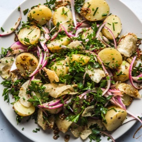

---
categories:
- 9B3E8F54-7F9D-4782-919F-ACC9A0850C87
- 60FB6093-F8C4-447B-A9A2-81A75BBCBA70
- 9B27D475-7644-4A83-9A71-DACE79FB649E
- 088012EF-69C0-412F-BD34-160FE5B0E043
cook_time: ''
created: '2020-07-29 22:06:07'
difficulty: ''
hash: f3e845f051db59cc37711bb5c6a3fd9787ac8cbb631cf627ab2a8d79561fbfe2
image_url: https://assets.bonappetit.com/photos/57acae77f1c801a1038bc6da/16:9/w_1880,c_limit/potato-salad-with-old-bay-and-potato-chips.jpg
in_trash: false
is_pinned: false
on_favorites: false
on_grocery_list: false
prep_time: ''
rating: 0
scale: null
servings: 6 servings
source: bonappetit.com
source_url: https://www.bonappetit.com/recipe/potato-salad-old-bay-potato-chips?intcid=inline_amp&_gl=1*wge2g9*_ga*YW1wLVRxZ3RmSE9VYnFTVVF0c1VfcmM0MU9fUFJ0SFBOQUpTZVpOUVJZakdrYkh0d1JjT1dVMW1CV2JjMmFzLTJQTk4.
total_time: ''
uid: F2DA5E6E-0A9C-41A0-B7E3-0236244FF099-69016-0000233FBA302634
---

# Potato Salad with Old Bay and Potato Chips

## Ingredients

- 2 lb small waxy potatoes, scrubbed, halved
- Kosher salt
- 1/4 cup olive oil, plus more for drizzling
- 1 small red onion, thinly sliced
- 1/4 cup apple cider vinegar
- 1 tbsp whole grain mustard
- 1 tsp Old Bay seasoning
- 1 tsp (or more) coarsely ground black pepper
- Pinch of cayenne pepper
- 2 cups kettle-cooked potato chips
- 1/4 cup coarsely chopped parsley
- 3 tbsp finely chopped chives

## Directions

Place potatoes in a large pot and pour in cold water to cover; season with salt. Bring to a boil; reduce heat and simmer until tender, 15-18 minutes. Drain and return to pot to dry out; let cool.

Meanwhile, heat 1/4 cup oil in a medium skillet over medium-high. Add onion; season with salt. Cook, stirring occasionally, until soft, about 5 minutes.

Transfer onion to a large bowl. Stir in vinegar, mustard, Old Bay, black pepper, and cayenne. Add potatoes, potato chips, parsley, and chives to vinaigrette and toss to combine. Taste and season with salt and black pepper if needed; drizzle with more oil.

Do Ahead: Vinaigrette can be made 3 days ahead; cover and chill.
