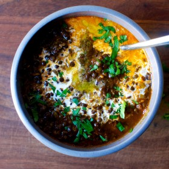

---
categories:
- 135D8DF8-5165-487A-9161-61345003AB1B
- F0D08EC3-D9EF-4F02-A381-FF3D38660DA6
- 641901A6-C962-46DC-B418-1C19B51409EF
- 98E4F68D-11D7-4383-90FA-22C804880E1C
cook_time: 1 hour
created: '2020-01-26 10:46:21'
difficulty: ''
hash: 96827d292c8a633863133a0f895ff2b0d56b4171311632e8f3f5334678d6177c
image_url: https://smittenkitchendotcom.files.wordpress.com/2017/03/black-lentil-dal.jpg?w=1024
in_trash: false
is_pinned: false
on_favorites: false
on_grocery_list: false
prep_time: ''
rating: 0
scale: null
servings: 'Servings: 4'
source: Smittenkitchen.com
source_url: https://smittenkitchen.com/2017/03/punjabi-style-black-lentil-dal/
total_time: ''
uid: A4E49D85-6BBC-4F41-BA09-5D8E8757B40C
---

# Punjabi-Style Black Lentils

## Ingredients

- 2 tablespoons oil, butter (regular or ghee)
- 1 medium onion, finely chopped
- 1/2 teaspoon cumin seeds
- 1-inch piece of ginger, finely chopped
- 2 garlic cloves, finely chopped
- 1 teaspoon ground coriander
- 1/4 teaspoon ground turmeric
- 1/2 teaspoon garam masala (optional but traditional)
- Ground chile powder, to taste (I started with a 1/2 teaspoon, but I have to keep things weak for kids)
- 1 cup finely chopped or pureed tomatoes, fresh or from a can
- 1 teaspoon fine sea salt, plus more to taste
- 1 cup dried black lentils
- 4 1/2 cups water, plus more to taste
- TO FINISH:
- 4 teaspoons butter (salted is lovely here)
- 2 tablespoons heavy cream
- Handful chopped fresh cilantro

## Directions

Make the dal: Heat oil (or oil and butter) over medium. Once hot, add onion and cumin seeds and cook, stirring occasionally, until onion browned in spots. Add garlic and ginger, cook for 1 minute more, then the rest of the spices and tomato and cook for 3 minutes more, scraping up any stuck bits. Add water and salt, then lentils. Bring to simmer, then reduce to low and cover and cook until lentils are tender, between 35 and 45 minutes, stirring occasionally. For a looser dal, you can add more water. Adjust spices and seasonings to taste.

To finish as shown: Ladle into four bowls. Place a 1-teaspoon pat of butter in the center of each, letting it begin to melt before swirling in 1 1/2 teaspoons cream and finishing with cilantro.
