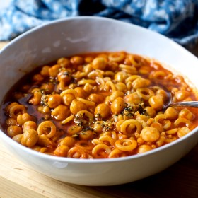

---
categories:
- 135D8DF8-5165-487A-9161-61345003AB1B
- F0D08EC3-D9EF-4F02-A381-FF3D38660DA6
- 460F3A6B-0B87-457B-AF84-A1CE51D92D74
- 98E4F68D-11D7-4383-90FA-22C804880E1C
cook_time: 20 minutes
created: '2020-01-26 10:45:05'
difficulty: ''
hash: d521df5a636471cdd5f50e06efc0b5d2e61e55245154efb7c3b188f9beb01abe
image_url: https://smittenkitchendotcom.files.wordpress.com/2017/10/quick-pasta-e-ceci-pasta-with-chickpeas.jpg?w=1024
in_trash: false
is_pinned: false
on_favorites: false
on_grocery_list: false
prep_time: ''
rating: 0
scale: null
servings: 'Servings: 2 to 3'
source: Smittenkitchen.com
source_url: https://smittenkitchen.com/2017/10/quick-pasta-and-chickpeas-pasta-e-ceci/
total_time: ''
uid: ADEF96C0-D0AC-48AE-8873-B523A887C435
---

# Quick Pasta and Chickpeas

## Ingredients

- 2 tablespoons olive oil
- 2 cloves garlic, peeled and smashed
- 3 tablespoons tomato paste
- 1 teaspoon kosher salt, plus more to taste
- Freshly ground black pepper or red pepper flakes, to taste
- 1 1/2 cups cooked chickpeas (from one 15-ounce can, drained and rinsed)
- 1/2 cup (2 ounces or 55 grams) uncooked ditalini pasta (or another small shape; I use annelini)
- 2 cups (475 ml) boiling water (update: actually I just use tap, not boiled, water)
- TO FINISH:
- 2 to 3 tablespoons olive oil (estimate 1 per serving)
- 1 clove of garlic, peeled and finely chopped
- 1 teaspoon minced fresh rosemary
- Salt and red pepper flakes

## Directions

In a medium-large heavy-bottomed pot or deep saute pan, heat 2 tablespoons olive oil until it shimmers. Add 2 smashed cloves of garlic and cook, stirring until it becomes lightly, barely browned but very fragrant. Stir in the tomato paste, salt, and pepper and cook them with the garlic for 30 seconds or so. Add the chickpeas, pasta, and boiling water. Stir to scrape up any browned bits on the bottom of the pot, lower the heat, and simmer until the pasta is cooked and a lot of the liquid has been absorbed, about 15 to 20 minutes. Taste and adjust seasoning and ladle into bowls.

Make finishing oil: Heat 2 to 3 tablespoons olive oil in a small sauce- or frying pan over medium-low heat with remaining clove of garlic, rosemary, a pinch or two of salt and pepper flakes, until sizzling; pull it off the heat as soon as the garlic is going to start taking on color. Drizzle this over bowls of pasta e ceci and eat it right away.
