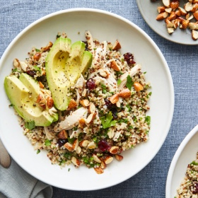

---
categories:
- 135D8DF8-5165-487A-9161-61345003AB1B
- E131025A-19E9-4C5F-99A8-75EE51F165D8
- 9B27D475-7644-4A83-9A71-DACE79FB649E
- 088012EF-69C0-412F-BD34-160FE5B0E043
cook_time: ''
created: '2024-03-31 10:34:02'
difficulty: ''
hash: ad4484eaaae34cce759dde179c58f12cfb9fbaeaa26ef08345838be28928d17d
image_url: https://static01.nyt.com/images/2018/08/17/dining/quinoa-salad-chicken/quinoa-salad-chicken-square640.jpg
in_trash: false
is_pinned: false
on_favorites: false
on_grocery_list: false
prep_time: ''
rating: 0
scale: null
servings: 4-6 servings
source: cooking.nytimes.com
source_url: https://cooking.nytimes.com/recipes/1019495-quinoa-salad-with-chicken-almonds-and-avocado?ds_c=&ds_c=71700000052595478&site=google&network=g&campaign_id=1400169272&gad_source=1&gbraid=0AAAAADwd30j-BsR0nxS0PgEuSKmr3OjIx&gclid=EAIaIQobChMIqpCJktyehQMVlHJHAR3E5gxzEAAYASAAEgKRGvD_BwE&gclsrc=aw.ds
total_time: 20 min
uid: 76CBFA52-3F96-4706-807D-7FC52EC8295C
---

# Quinoa Salad with Chicken, Almonds and Avocado

## Ingredients

- 2 cups tricolor quinoa (12 oz), rinsed well and drained
- 1/4 cup finely diced shallot or onion
- 3 tbsp sherry vinegar
- 1 tbsp Dijon mustard
- 1/3 cup extra-virgin olive oil
- Kosher salt and black pepper
- 2 cups leftover chicken meat, torn from a rotisserie bird
- 3/4 cup dried cranberries
- 2 cups fresh flat-leaf parsley, chopped
- 1/2 cup roasted salted almonds, chopped
- 1 avocado, pitted, peeled and thinly sliced

## Directions

Bring a large saucepan of generously salted water to a boil. Add quinoa and boil, stirring occasionally, until tender, 10-15 minutes.

Meanwhile, whisk the shallot, vinegar, mustard, oil and a generous pinch of salt and pepper in a very large bowl. When quinoa is done, drain very well, then add to the dressing, along with the chicken, cranberries and parsley. Fold until evenly mixed and cooled, then season to taste with salt and pepper.

Divide the salad among dishes and top with the chopped almonds and avocado.

## Notes

It’s fastest and easiest to rinse grains in a sieve. Simply run cold water over them while gently shaking the sieve, then gently shake dry. It’s important to rinse grains to clean them and in the case of quinoa, to remove saponins, which can leave a bitter or soapy aftertaste. As it’s also tough to get flavors into grains once they’re cooked, it's a good idea to season them with salt at this point.

## Nutritional Information

Trans Fat: 0 g
Fat: 29 g
Calories: 605
Saturated Fat: 4 g
Unsaturated Fat: 23 g
Sodium: 574 milligrams
Sugar: 16 g
Fiber: 10 g
Carbohydrate: 61 g
Protein: 28 g
