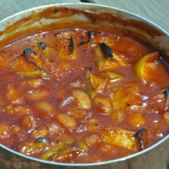

---
categories:
- 9B3E8F54-7F9D-4782-919F-ACC9A0850C87
- F0D08EC3-D9EF-4F02-A381-FF3D38660DA6
- 1C21D75E-3CF2-4B23-B04F-A9275BC1033B
- 98E4F68D-11D7-4383-90FA-22C804880E1C
cook_time: ''
created: '2020-12-13 14:48:30'
difficulty: ''
hash: b0520cbe4446199658d9655e470790b76732d1af42b93af3ab67f6bb2e9a80c4
image_url: https://randallbeans.com/wp-content/uploads/2013/05/apple-bean-bake.jpeg
in_trash: false
is_pinned: false
on_favorites: false
on_grocery_list: false
prep_time: ''
rating: 0
scale: null
servings: ''
source: randallbeans.com
source_url: https://randallbeans.com/2015/12/29/randall-apple-bean-bake/
total_time: ''
uid: 41D652E9-FC4F-4579-A6C8-CB42C008511A-43240-00001B2B170D9988
---

# Randall Apple Bean Bake

## Ingredients

- 1 (48 oz) jar Randall Great Northern Beans, drained
- 4 tbsp butter
- 2 large Granny Smith or any type of cooking apples, cubed (3 cups)
- 1/2 cup brown sugar
- 1/4 cup white sugar
- 1/2 cup ketchup
- 1 tsp cinnamon
- 1 tbsp molasses
- 1 tsp salt

## Directions

In large skillet, melt butter, add cubed apples and cook until tender.

Add brown sugar and white sugar, stir and cook until sugar is melted.

Stir in catsup, cinnamon, molasses, and salt. Add beans and mix well.

Pour mixture into 2 quart casserole. Bake in a 400°F oven for about 1 hour. Serves 6-8.
