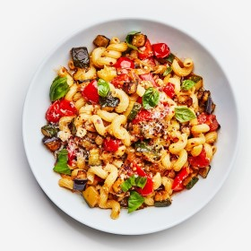

---
categories:
- 135D8DF8-5165-487A-9161-61345003AB1B
- 60FB6093-F8C4-447B-A9A2-81A75BBCBA70
- 460F3A6B-0B87-457B-AF84-A1CE51D92D74
- 98E4F68D-11D7-4383-90FA-22C804880E1C
cook_time: ''
created: '2020-01-26 10:33:01'
difficulty: ''
hash: 2b9d481995034bfbefb4ba2d7a05b8b29f84f3ed3b42a2945d06e5b3684c0ddd
image_url: https://assets.bonappetit.com/photos/5d4356436f98a4000898782b/3:2/w_1880,c_limit/Basically-Ratatouille-Pasta.jpg
in_trash: false
is_pinned: false
on_favorites: false
on_grocery_list: false
prep_time: ''
rating: 0
scale: null
servings: 4-6 servings
source: Bonappetit.com
source_url: https://www.bonappetit.com/recipe/ratatouille-pasta
total_time: ''
uid: FD31C20B-BF2D-4738-AC33-0E8708296E6E
---

# Ratatouille Pasta

## Ingredients

- 1 large or 2 medium Italian eggplants (about 1 1/2 lb)
- Kosher salt
- 1 large or 2 small red bell peppers (about 9 oz)
- 1 large zucchini (about 8 oz)
- 2 medium onions
- 1 pint cherry tomatoes
- 4 garlic cloves
- 1 lemon
- 1 1/2 oz Parmesan
- 1/2 cup extra-virgin olive oil, divided, plus more for drizzling
- 1/4 cup capers
- 1/2 tsp crushed red pepper flakes, plus more for serving
- 1 lb cavatappi
- 1 1/2 cups basil leaves, torn if large, plus more for serving

## Directions

Cut 1 large or 2 medium Italian eggplants into 1/2" pieces. Transfer to a colander set over a medium bowl and sprinkle with 2 tsp salt. Let sit 30 minutes. Your eggplant might start to discolor and should start to release some brownish liquid that will fall into the bowl below. That’s good! It’s losing excess moisture that would prevent it from getting silky-soft.

Meanwhile, cut 1 large or 2 small red bell peppers and 1 large zucchini into 1/2" pieces. Transfer to a medium bowl. Peel 2 medium onions, cut through root end, then slice through root end into thin slivers. Transfer to bowl with bell peppers. Halve 1 pint cherry tomatoes (the fastest—but dorkiest—way to do this is to sandwich them between two quart container lids) and transfer to a small bowl. Smash 4 garlic cloves, then coarsely chop and add to bowl with tomatoes. Slice 1 lemon in half; set aside. Finely grate 1 1/2 oz Parmesan with a Microplane or the small holes of a box grater into another small bowl.

Slide 1 of 5

PREVIOUS NEXT

Your eggplant needs special treatment: Cooking it separately guarantees that you can make it tender and golden (rather than chewy and gray) without over-cooking it or causing the other veg to get soggy. When eggplant has been sitting 30 minutes (okay, 25 if you’re antsy), gently squeeze it to get rid of any more moisture (less moisture means more browning). No need to go crazy, though.

Heat 2 tbsp extra-virgin olive oil in a large Dutch oven or heavy pot over high until shimmering. Once hot (test with one piece for starters!), add half of eggplant and stir to coat in oil. Cook, stirring every 3 minutes or so (you want to leave it undisturbed while also making sure lots of pieces get their time against the hot pan), until eggplant is golden, with some pieces starting to brown and char, 5-7 minutes. Reduce heat to medium if eggplant is browning too quickly. Using a slotted spoon or fish spatula, transfer to a plate. If any eggplant pieces stick, just scrape them up—no biggie. Heat 2 tbsp extra-virgin oil over high. Cook remaining eggplant using same process, 5-7 minutes. Transfer to plate with cooked eggplant.

Scrape off any bits of eggplant from pot if needed (no need to wipe out). Heat 1/4 cup extra-virgin olive oil over medium-high. Add 1/4 cup capers and 1/2 tsp red pepper flakes (don’t be alarmed if capers sputter and foam—it’s because they’re wet!). Cook, stirring, until bubbling subsides, 30-60 seconds.

Add onion-pepper mixture, season with 1 1/2 tsp salt, and cook, stirring frequently, scraping bottom of pan, and reducing heat if vegetables are getting too brown, until vegetables are softened, slumped, and have started to take on lots of color, 12-15 minutes. Meanwhile, bring a large pot of generously salted water to a boil (this is for your pasta).

Add tomato-garlic mixture to sauce, reduce heat to medium-low, and cook, stirring occasionally with a wooden spoon, until almost all tomatoes have burst and vegetables are starting to break down and deeply caramelize, about 10 minutes. Keep an eye on it and reduce heat if veg is getting too dark for your liking.

Finish the sauce: Return eggplant to pot and cook until vegetables are tender but the vegetable pieces are still distinct (you don't want total mush), about 5 more minutes. Taste and season with salt.

Add pasta to boiling water right after you add the eggplant, stirring occasionally, until al dente. Before draining, scoop out 1 cup pasta cooking liquid with a liquid measuring cup.

Now the exciting part: Ratatouille and pasta join forces as one. Reduce heat over sauce to low. Add drained pasta and stir to coat in sauce. Add 1 cup Parmesan, pour 1/2 cup pasta cooking liquid over, then stir vigorously with a rubber spatula or wooden spoon until a creamy sauce forms with no clumps of cheese. Add more pasta cooking liquid as necessary if pasta starts to stiffen. Remove from heat. Squeeze juice from 1/2 lemon over, then stir in 1 1/2 cups basil. Taste for salt and lemon juice.

Slide 1 of 2
