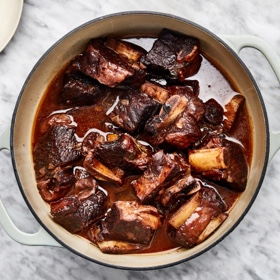

---
categories:
- 135D8DF8-5165-487A-9161-61345003AB1B
- 55A42913-CF04-4D09-BB3B-A0886EAA8EC1
- A774024D-4AFA-4EB2-B28E-8925ACA5E85C
- 2BBE169B-4709-4377-8F54-765FFAAD9E1A
cook_time: ''
created: '2020-05-26 09:10:35'
difficulty: ''
hash: 430562e5128dea234788ce721b0f1b546564acce86bfb67c4dec87558180080f
image_url: https://assets.bonappetit.com/photos/5c4b21e785b9bd2cf3b17454/16:9/w_1880,c_limit/red-wine-braised-short-ribs.jpg
in_trash: false
is_pinned: false
on_favorites: false
on_grocery_list: false
prep_time: ''
rating: 0
scale: null
servings: 6 servings
source: bonappetit.com
source_url: https://www.bonappetit.com/recipe/red-wine-braised-short-ribs
total_time: ''
uid: 1A113C4A-51A0-47C6-890C-2B70B202EB2B-381-000000C319C173BB
---

# Red Wine-Braised Short Ribs

## Ingredients

- 5 lb bone-in beef short ribs, cut crosswise into 2-inch pieces
- Kosher salt and freshly ground black pepper
- 3 tbsp vegetable oil
- 3 medium onions, chopped
- 3 medium carrots, peeled, chopped
- 2 celery stalks, chopped
- 3 tbsp all-purpose flour
- 1 tbsp tomato paste
- 1 750 ml bottle dry red wine (preferably Cabernet Sauvignon)
- 10 sprigs flat-leaf parsley
- 8 sprigs thyme
- 4 sprigs oregano
- 2 sprigs rosemary
- 2 fresh or dried bay leaves
- 1 head of garlic, halved crosswise
- 4 cups low-salt beef stock

## Directions

Preheat oven to 350°F. Season short ribs with salt and pepper. Heat oil in a large Dutch oven over medium-high. Working in 2 batches, brown short ribs on all sides, about 8 minutes per batch. Transfer short ribs to a plate. Pour off all but 3 tbsp drippings from pot.

Add onions, carrots, and celery to pot and cook over medium-high heat, stirring often, until onions are browned, about 5 minutes. Add flour and tomato paste; cook, stirring constantly, until well combined and deep red, 2-3 minutes. Stir in wine, then add short ribs with any accumulated juices. Bring to a boil; lower heat to medium and simmer until wine is reduced by half, about 25 minutes. Add all herbs to pot along with garlic. Stir in stock. Bring to a boil, cover, and transfer to oven.

Cook until short ribs are tender, 2-2 1/2 hours. Transfer short ribs to a platter. Strain sauce from pot into a measuring cup. Spoon fat from surface of sauce and discard; season sauce to taste with salt and pepper. Serve in shallow bowls over mashed potatoes with sauce spooned over.
