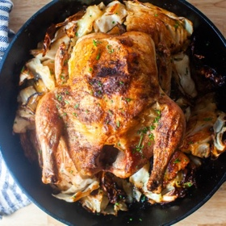

---
categories:
- 135D8DF8-5165-487A-9161-61345003AB1B
- E131025A-19E9-4C5F-99A8-75EE51F165D8
- 3C8ADFAF-87C1-4C30-AA13-572072B4B626
- 2BBE169B-4709-4377-8F54-765FFAAD9E1A
cook_time: 1 hour
created: '2022-09-18 09:24:57'
difficulty: ''
hash: dde423bf632654a83d2d0db655ff54292c349921c02e0143762c5f5f200026cb
image_url: https://i1.wp.com/smittenkitchen.com/wp-content/uploads//2020/04/roast-chicken-with-schmaltzy-cabbage.jpg?fit=750%2C500&ssl=1
in_trash: false
is_pinned: false
on_favorites: false
on_grocery_list: false
prep_time: ''
rating: 0
scale: null
servings: 'Servings: 4'
source: smittenkitchen.com
source_url: https://smittenkitchen.com/2020/04/roast-chicken-with-schmaltzy-cabbage/
total_time: ''
uid: 542FB090-7CAF-4EE3-8EB8-D2D2D24F40DA
---

# Roast Chicken with Schmaltzy Cabbage

## Ingredients

- 1 large head (2 1/2 lb) green cabbage
- Splash of oil, any kind
- Kosher salt
- Freshly ground black pepper
- 1 whole chicken (shown here is 3 lb)
- 4 tbsp unsalted butter, melted
- A lemon, if you wish, for serving (we never used ours)

## Directions

Heat your oven to 450°F. Halve your cabbage and slice each half into 1-1.5-inch thick slabs. Very thinly coat the bottom of a 12-inch ovensafe skillet* or an equivalent roasting pan with oil, just to keep the cabbage from sticking before juices trickle down. Arrange cabbage slices in the pan as if you were making a mosaic, cutting pieces down as needed to get them to fit tightly. Season cabbage with salt and pepper. Pat your chicken dry and rub or brush it with 1 tbsp of the butter. Generously salt and pepper the chicken all over (I use a full tbsp of Diamond kosher salt on my 3-lb bird; use half of another brand). Place chicken breast side-up over the cabbage and roast for 45-60 minutes, spooning the bird and cabbage around it with butter a few times throughout. Chicken is done when a thermometer inserted into the thickest part of the breast reads 155°F, or 165°F for the thigh. If your chicken is much larger and you find it’s getting too dark for your tastes, reduce the heat to 425.

Lift the chicken off the cabbage and set on a plate (or warmed tray) to rest. Flip each section of cabbage over carefully in the pan, nestling them back in, and return the pan to the oven for 5-10 minutes at 450°F, until the edges are very dark brown. Season with more salt and pepper if needed.

Cut chicken into pieces and serve with the cabbage, finishing everything with lemon if you wish.

I swear by this frying pan (I’ve had mine for 16 years and plan to keep it forever), this thermometer, and this spatula.
