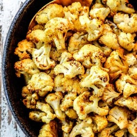

---
categories:
- 9B3E8F54-7F9D-4782-919F-ACC9A0850C87
- 60FB6093-F8C4-447B-A9A2-81A75BBCBA70
- 1C21D75E-3CF2-4B23-B04F-A9275BC1033B
- 2BBE169B-4709-4377-8F54-765FFAAD9E1A
cook_time: ''
created: '2020-01-26 11:30:35'
difficulty: ''
hash: 719a0f13487d0d8d097a819433fe35f9efedd394119ed51d6563baaa5e1080a0
image_url: null
in_trash: false
is_pinned: false
on_favorites: false
on_grocery_list: false
prep_time: ''
rating: 0
scale: null
servings: ''
source: ''
source_url: ''
total_time: ''
uid: 4CEFD719-4DDE-4219-8684-4A22AF2C446A
---

# Roasted Cauliflower

## Ingredients

- 1 head cauliflower
- Olive oil

## Directions

Oven @ 400
~ 25 min
