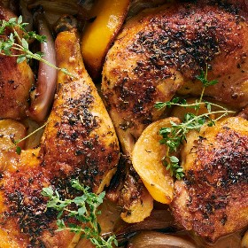

---
categories:
- 135D8DF8-5165-487A-9161-61345003AB1B
- E131025A-19E9-4C5F-99A8-75EE51F165D8
- 1C21D75E-3CF2-4B23-B04F-A9275BC1033B
- 2BBE169B-4709-4377-8F54-765FFAAD9E1A
cook_time: ''
created: '2026-10-04 17:22:38'
difficulty: ''
hash: fff94e030d3beed164809d8997f039689d1defeb9b77a0535a70ec81b865ce71
image_url: https://static01.nyt.com/images/2025/07/22/multimedia/22MS-FOODMANREX-lzwf/22MS-FOODMANREX-lzwf-videoSixteenByNineJumbo1600.jpg
in_trash: false
is_pinned: false
on_favorites: false
on_grocery_list: false
prep_time: ''
rating: 4
scale: null
servings: 4 servings
source: Cooking.nytimes.com
source_url: https://cooking.nytimes.com/recipes/1017327-roasted-chicken-provencal?unlocked_article_code=1.GFE.IFPJ.4Qt65bv4jkpV
total_time: 1 hr 15 min
uid: 54886CF1-033E-4C5E-8FDB-4C9D9CD84BEF
---

# Roasted Chicken Provençal

## Ingredients

- 4 chicken legs or 8 bone-in, skin-on chicken thighs
- 2 teaspoons kosher salt
- 1 teaspoon freshly ground black pepper
- ½ to ¾ cup all-purpose flour
- 3 tablespoons olive oil
- 2 tablespoons herbes de Provence
- 1 lemon, quartered
- 8 to 10 cloves garlic, peeled
- 4 to 6 medium-size shallots, peeled and halved
- ⅓ cup dry vermouth
- 4 sprigs of thyme, for serving

## Directions

Heat oven to 400 degrees. Season the chicken with salt and pepper. Put the flour in a shallow pan, and lightly dredge the chicken in it, shaking the pieces to remove excess flour.

Swirl the oil in a large roasting pan, and place the floured chicken in it. Season the chicken with the herbes de Provence. Arrange the lemon, garlic cloves and shallots around the chicken, then add the vermouth to the pan.

Put the pan in the oven, and roast for 25 to 30 minutes, then baste it with the pan juices. Continue roasting for another 25 to 30 minutes, or until the chicken is very crisp and the meat cooked through.

Serve in the pan or on a warmed platter, garnished with the thyme.
