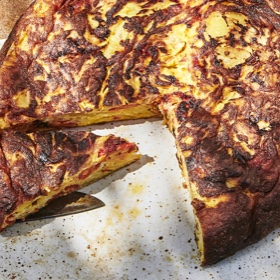

---
categories:
- 595E8D63-42D3-4E28-88A2-D6D54EF026A1
- EAB653D6-0540-48C4-B9D0-FD56AE24841E
- 1C21D75E-3CF2-4B23-B04F-A9275BC1033B
- 2BBE169B-4709-4377-8F54-765FFAAD9E1A
cook_time: ''
created: '2020-07-28 18:58:49'
difficulty: ''
hash: 73f893732efcebb5b04120923b6f06cdb6c483d266e5c1772f8fb0da9d131672
image_url: https://assets.bonappetit.com/photos/5d1caf7b0813410008e914fa/16:9/w_1880,c_limit/Print-Scribe-Roasted-Red-Pepper-Frittata.jpg
in_trash: false
is_pinned: false
on_favorites: false
on_grocery_list: false
prep_time: ''
rating: 0
scale: null
servings: 8 servings
source: bonappetit.com
source_url: https://www.bonappetit.com/recipe/roasted-red-pepper-frittata
total_time: ''
uid: 742E7CDF-D1F4-4319-95C5-2BBF3BE0DAA9-532-000000A1CA3A33D5
---

# Roasted Red Pepper Frittata

## Ingredients

- 2 medium red bell peppers
- 1¼ cups extra-virgin olive oil, plus more for drizzling
- Kosher salt
- 1 large onion, thinly sliced
- 1½ lb. German Butterball potatoes (about 6), peeled, sliced ¼" thick
- 8 large eggs

## Directions

Preheat oven to 400°. Place bell peppers on a rimmed baking sheet, drizzle with oil, and turn to coat. Season with salt. Roast peppers, turning every 5 minutes, until softened and skins look wrinkly and lightly blistered, 20–25 minutes. Let cool slightly. Peel and remove seeds from bell peppers, then cut flesh into ½"-thick slices. (You should have about 1 cup.)

Meanwhile, toss together onion and potatoes in an 8" cast-iron skillet; season with salt. Cover with 1¼ cups oil and set over medium heat. Bring to a gentle simmer, about 3 minutes, and cook, stirring occasionally with a wooden spoon and scraping the bottom of the pan to minimize sticking, reducing heat if needed, until there is no crunch left to the onion (do not let it take on any color) and the potatoes are tender, 25–30 minutes. Taste a piece of potato and onion to check. Some of the mixture may stick to the pan, and some of the potatoes may break into smaller pieces toward the end of cooking—both of these things are okay. Transfer to a medium bowl; let cool until warm, 8–10 minutes. Stir in roasted peppers.

Clean skillet and place in oven to heat. Whisk eggs in a medium bowl until no streaks remain; season with salt. Using a slotted spoon or tongs, lift vegetables out of the oil and add to eggs (this is best done while they are still warm). Set onion-potato oil aside.

Transfer skillet to stovetop and continue to heat over high until ripping hot, about 5 minutes. Add 3 Tbsp. reserved onion-potato oil to pan, then pour in egg mixture. Cook, using a heatproof rubber spatula or wooden spoon to pull egg mixture from the outer edges into the center, allowing uncooked egg to flow underneath and dragging the hotter, more-set egg from the edges into the center. This will help frittata cook evenly. Transfer skillet back to the oven and bake the frittata until browned and set, 10–14 minutes. Let frittata cool in pan 5–10 minutes, then invert onto a platter and cut into wedges to serve.

Do Ahead: Bell peppers can be roasted 2 days ahead; cover and chill. Remove from refrigerator when you start prepping other ingredients so that they’re not fridge-cold when you combine them with the eggs.
