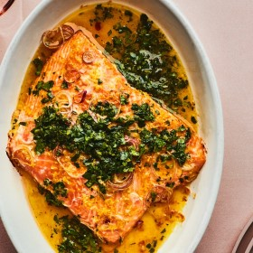

---
categories:
- 135D8DF8-5165-487A-9161-61345003AB1B
- 0E6E410A-45EC-4274-98C8-2190B87DB54A
- 1C21D75E-3CF2-4B23-B04F-A9275BC1033B
- 2BBE169B-4709-4377-8F54-765FFAAD9E1A
cook_time: ''
created: '2020-01-26 11:07:43'
difficulty: ''
hash: d34cdebdd6628baf93219845d21059ad51fbc4c956128c6cf02d329b3e926b5d
image_url: https://assets.bonappetit.com/photos/5c9401b69a9ff02084e4da50/16:9/w_1880,c_limit/01032019-BA17151.jpg
in_trash: false
is_pinned: false
on_favorites: false
on_grocery_list: false
prep_time: ''
rating: 0
scale: null
servings: 4 servings
source: Bonappetit.com
source_url: https://www.bonappetit.com/recipe/roasted-salmon-salsa-verde
total_time: ''
uid: A80B1B00-D1D7-4B32-A3ED-D769CAA11408
---

# Roasted Salmon with Citrus Salsa Verde

## Ingredients

- 1 shallot, very thinly sliced into rings
- Finely grated zest from 1 orange, divided
- Finely grated zest from 1 lemon, divided
- 1 tbsp plus 1/2 cup extra-virgin olive oil
- 1 lb salmon fillet, preferably wild
- Kosher salt
- 1/2 cup chopped cilantro
- 1/2 cup chopped parsley
- 1 small garlic clove, finely grated
- 1/2 tsp smoked paprika
- Fresh juice from 1 orange
- Fresh juice from 1 lemon

## Directions

Preheat oven to 250°F. Combine shallot, half of orange zest, half of lemon zest, and 1 tbsp oil in a small baking dish just large enough to fit salmon. Season salmon with salt and coat with zest mixture. Bake fish until fillet is just opaque in the center and flakes with a fork, 30-35 minutes.

Meanwhile, mix cilantro, parsley, garlic, paprika, remaining zests, and 1/2 cup oil in a medium bowl. Stir in orange and lemon juice and season citrus salsa verde with salt just before spooning over fish.
