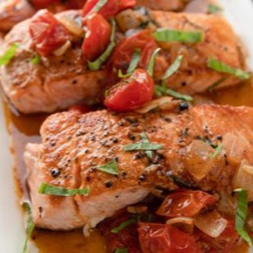

---
categories:
- 135D8DF8-5165-487A-9161-61345003AB1B
- 0E6E410A-45EC-4274-98C8-2190B87DB54A
- 3C8ADFAF-87C1-4C30-AA13-572072B4B626
- 2BBE169B-4709-4377-8F54-765FFAAD9E1A
cook_time: 50 min
created: '2023-03-19 17:22:11'
difficulty: Easy
hash: 1f5ca5fe15d46135cbe6c06cee68f36faa28f55ce22d164fb6393631f51df873
image_url: https://food.fnr.sndimg.com/content/dam/images/food/fullset/2019/4/8/0/BX1602_Salmon-and-Melting-Cherry-Tomatoes_s4x3.jpg.rend.hgtvcom.406.305.suffix/1554767123290.jpeg
in_trash: false
is_pinned: false
on_favorites: false
on_grocery_list: false
prep_time: 45 min
rating: 0
scale: null
servings: 'Yield: 4 servings'
source: foodnetwork.com
source_url: https://www.foodnetwork.com/recipes/ina-garten/salmon-and-melting-cherry-tomatoes-6565408.amp
total_time: ''
uid: 31D29F88-6C7C-4456-A61F-5A9B4DDAA6F8
---

# Salmon & Melting Cherry Tomatoes

## Ingredients

- Good olive oil

- 1 cup chopped sweet onion, such as Vidalia

- 2 tsp minced garlic (2 cloves)

- 2 cups (1 pint) cherry or grape tomatoes, halved through the stem

- Kosher salt and freshly ground black pepper

- 1 1/2 tbsp good balsamic vinegar

- 1 1/2 tbsp julienned fresh basil leaves

- 1 (2-lb) salmon fillet, cut crosswise into 4 pieces

## Directions

Preheat the oven to 425°F.

Heat 3 tbsp of the olive oil in a medium (10-inch) saute pan. Add the onion and saute over medium-low heat for 5 minutes, stirring occasionally, until very tender but not browned. Add the garlic and saute for 1 more minute. Stir in the tomatoes, 1 tsp salt, and 1/2 tsp pepper and cook over medium-low heat for 10-15 minutes, stirring occasionally, until the liquid evaporates and the tomato sauce thickens slightly. Off the heat, stir in the vinegar and basil.

Meanwhile, place a large (12-inch) cast-iron pan over high heat for 5 minutes. Brush the salmon all over with olive oil, sprinkle liberally with salt and pepper, and place it skin side up in the pan. Cook the fish for 3-4 minutes without moving them, until browned. Turn the salmon skin side down with a small metal spatula and transfer the pan to the oven for 8 minutes. (The salmon will not be completely cooked through.) Remove the fish to a serving platter, cover with aluminum foil, and allow to rest for 5 minutes.

Reheat the tomatoes, season to taste, and serve hot, warm, or at room temperature along with the salmon.

## Nutritional Information

1 of 4 servings
Calories: 554
Total Fat: 36
Saturated Fat: 8
Carbohydrates: 9
Dietary Fiber: 2
Sugar: 5
Protein: 48
Cholesterol: 125
Sodium: 858
