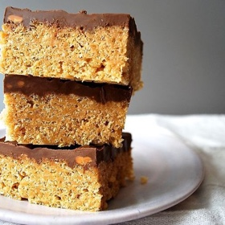

---
categories:
- 6BF378BD-8FD0-4FEF-9755-940308F0C8C7
- 60FB6093-F8C4-447B-A9A2-81A75BBCBA70
- 1C21D75E-3CF2-4B23-B04F-A9275BC1033B
- 98E4F68D-11D7-4383-90FA-22C804880E1C
cook_time: 10 minutes
created: '2021-09-25 10:22:57'
difficulty: ''
hash: 1071350751b0f0aacad57b5521248f4e794c1e01a2509ad94dd6956fb2503bd9
image_url: https://images.food52.com/lfE5EKJQ1oaTNEIGbHpHlFoQggg=/750x500/a126d2c1-3f26-48ba-ac7e-5f1941762da0--4f0cd34d-4c26-4109-b54e-fe44ac1bd951-DSC_0388.JPG
in_trash: false
is_pinned: false
on_favorites: false
on_grocery_list: false
prep_time: 1 hour 15 minutes
rating: 0
scale: null
servings: One 9- by 13-inch pan
source: food52.com
source_url: https://food52.com/recipes/38091-scotcheroos-rice-krispies-with-peanut-butter-butterscotch-chocolate
total_time: ''
uid: 975D63FB-8D82-43C4-B844-DD2CB8EE53BA
---

# Scotcheroos (Rice Krispies with Peanut Butter, Butterscotch & Chocolate)

## Ingredients

- 1 cup sugar
- 1 cup light corn syrup
- 1 cup creamy peanut butter
- 6 cups Rice Krispies cereal
- 1 cup semisweet chocolate chips
- 1 cup butterscotch chips

## Directions

Measure out all your ingredients and have them at the ready. Line a 9- by 13-inch pan with parchment and lightly grease the parchment.

In a small saucepan, combine the sugar and the corn syrup. Stir to form a grainy paste. Bring to a boil and cook until the sugar dissolves and large bubbles form across the surface. Remove from heat and quickly stir in the peanut butter. Mix well.

Measure the Rice Krispies into a large mixing bowl and pour the peanut butter mixture over top. Stir to coat evenly. Pour the cereal mixture into your prepared pan.

Wet your hands and press the cereal mixture evenly and firmly into the pan.

In a medium heatproof bowl, combine the chocolate and butterscotch chips and microwave in 30-second increments until melted. Stir between each 30-second increments (it usually takes a total of about 1 1/2 minutes). Stir to ensure the chocolate is all melted smoothly.

Pour the chocolate mixture over the top of the cereal. Use a spatula to smooth the chocolate layer.

Let the bars cool at room temperature or in the refrigerator for at least an hour to firm up. Slice and eat!
